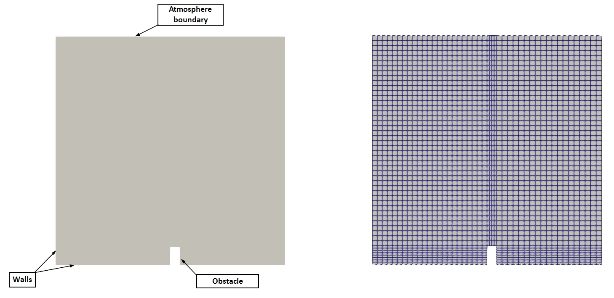
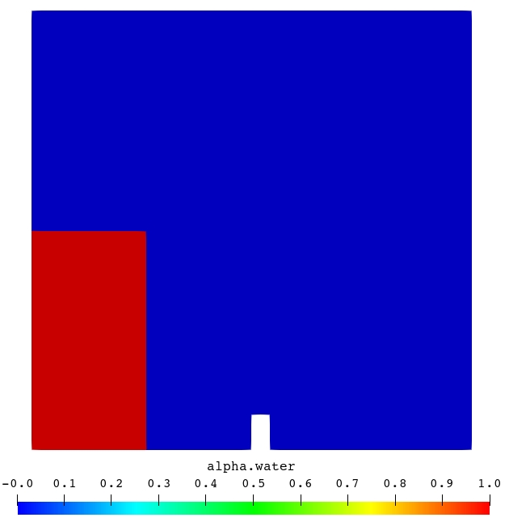
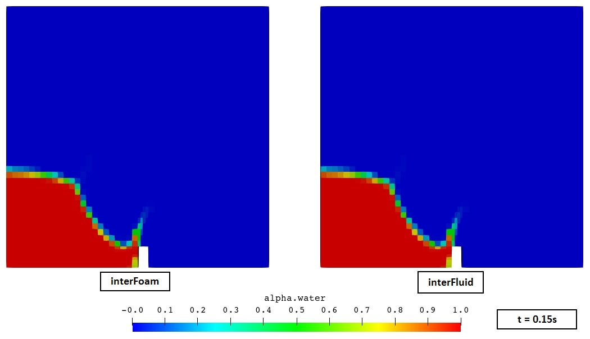
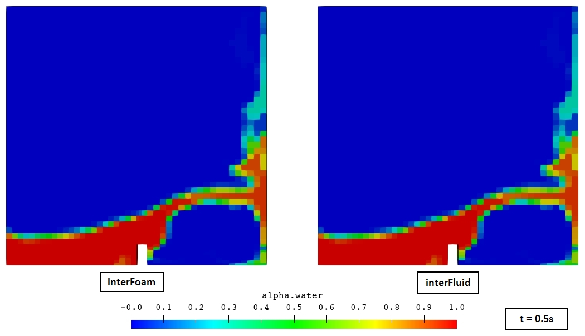
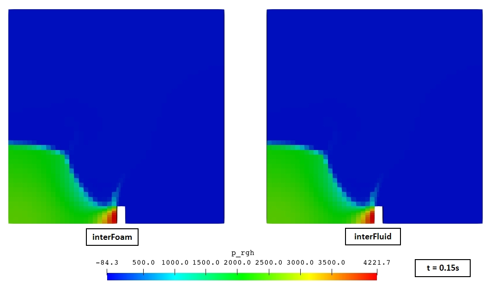

**Repository path:** `tutorials/singleRegion/interFluid/damBreak`

## Tutorial aims

- Demonstrate how to solve an incompressible, isothermal, immiscible two-phase flow problem using the `interFluid` region type (algebraic VOF with MULES).
- Demonstrate how to perform a single-region, transient analysis with adaptive time stepping in multiPhysicsFoam.
- Demonstrate verification of a ported region type against the stock OpenFOAM solver (`interFoam`) on the same case.
- Demonstrate how to monitor a free-surface simulation beyond field plots: water-level gauges, phase-volume conservation, boundedness of $\alpha$, Courant-number/time-step history and continuity errors.

## Case Overview


**Case geometry and mesh**

This case simulates the collapse of a rectangular column of water in a tank. It is the multiPhysicsFoam counterpart of the classic OpenFOAM `interFoam` *laminar/damBreak* tutorial. The geometry, mesh, boundary conditions, schemes and solver settings are the same. The only difference is that the problem is solved through the multiPhysicsFoam framework using the `interFluid` region type in *single-region mode*.

The domain is a square tank, $0.584 \times 0.584$ m, one cell thick in $z$ (0.0146 m). A small rectangular obstacle sits on the tank floor at $x \in [0.292, 0.316]$ m and is 0.048 m high. At $t = 0$ a column of water fills the lower left corner, $x \le 0.1461$ m and $y \le 0.292$ m, and the rest of the tank is air. Under gravity the column collapses, a surge front runs along the floor, hits the obstacle and is thrown up as a jet. The jet strikes the right wall and folds back over itself. Air is entrained and the water eventually sloshes back towards the left. The top of the tank is open to the atmosphere.

The mesh is made of 5 `blockMesh` blocks, 2268 hexahedral cells in total

The two phases are water (phase 1, $\rho_1 = 1000$ kg/m³, $\nu_1 = 10^{-6}$ m²/s) and air (phase 2, $\rho_2 = 1$ kg/m³, $\nu_2 = 1.48 \times 10^{-5}$ m²/s), with surface tension $\sigma = 0.07$ N/m. The flow is laminar.

This case is chosen because it exercises every part of the `interFluid` algorithm at once: a large density ratio (1000:1), a strongly deforming and topologically changing interface (breaking, entrainment, reconnection), surface tension, gravity through the $p_{rgh}$ decomposition, an open boundary where fluid can leave the domain, and adaptive time stepping limited by both the flow and the interface Courant number.

The governing model describes both fluids with **one** velocity and pressure field. The phase-fraction field $\alpha_1$ ($=1$ in water, $=0$ in air) tells them apart:

$$
\nabla \cdot \mathbf{U} = 0
$$

$$
\frac{\partial \alpha_1}{\partial t} + \nabla \cdot \left(\alpha_1 \mathbf{U}\right) + \nabla \cdot \left(\alpha_1 (1 - \alpha_1)\,\mathbf{U}_r\right) = 0
$$

$$
\frac{\partial (\rho \mathbf{U})}{\partial t} + \nabla \cdot \left(\rho \mathbf{U}\mathbf{U}\right) - \nabla \cdot \mathbf{R}
= -\nabla p_{rgh} - (\mathbf{g} \cdot \mathbf{h})\,\nabla \rho + \sigma \kappa \nabla \alpha_1
$$

with mixture density and viscosity $\rho = \alpha_1\rho_1 + (1-\alpha_1)\rho_2$ and $\mu = \alpha_1\rho_1\nu_1 + (1-\alpha_1)\rho_2\nu_2$. The last term of the $\alpha_1$ equation is an artificial compression term that keeps the interface sharp. It is only active where $0 < \alpha_1 < 1$. The solver solves for $p_{rgh} = p - \rho\,\mathbf{g}\cdot\mathbf{h}$, and the static pressure $p$ is recovered afterwards. The full model is described in `docs/regions/interFluid.md`.

The algorithm executed on every time step is:

```pseudocode
for all time-steps
    compute flow Courant number Co and interface Courant number Co_alpha
    set deltaT from maxCo / maxAlphaCo (getMinDeltaT + setDeltaT.H)
    for nOuterCorrectors                          (PIMPLE, here 1)
        prePredictor:
            re-read alpha controls
            MULES predictor (MULESCorr): implicit upwind solve for alpha.water
            for nAlphaCorr                        (here 2)
                MULES-limited high-order + compression correction
            rho = alpha1*rho1 + alpha2*rho2;  rhoPhi from the MULES flux
            update interface normal, curvature, surface-tension force
        momentumPredictor:
            assemble UEqn:  ddt(rho,U) + div(rhoPhi,U) + turbulence == fvOptions
            (not solved: momentumPredictor no)
        pressureCorrector:
            for nCorrectors                       (PISO, here 3)
                HbyA, phiHbyA (+ ddtCorr), phig = (F_sigma - ghf*snGrad(rho))*rAUf*|Sf|
                solve laplacian(rAUf, p_rgh) == div(phiHbyA + phig)
                correct phi and U; report continuity errors
                p = p_rgh + rho*gh
            turbulence->correct()
            sigma = -p*I + mu*devTwoSymm(grad(U))   (Cauchy stress, for FSI)
    write fields; execute function objects (sampling)
end
```

```note
In stock `interFoam` this loop lives in the solver's `main()`. In multiPhysicsFoam the executable only runs the time loop. The framework's `regionTypeList::solvePIMPLE()` calls `prePredictor()`, `momentumPredictor()` and `pressureCorrector()` of the `interFluid` region once per outer corrector. The order of operations is the same.
```

---
## Case Structure

The case structure follows the typical OpenFOAM case structure:

```plaintext
damBreak
├── 0.orig
│   ├── U
│   ├── alpha.water
│   └── p_rgh
├── Allclean
├── Allrun
├── constant
│   ├── g
│   ├── polyMesh
│   │   └── …
│   ├── transportProperties
│   └── turbulenceProperties
└── system
    ├── blockMeshDict
    ├── controlDict
    ├── decomposeParDict
    ├── fvSchemes
    ├── fvSolution
    ├── sampling
    └── setFieldsDict
```

- `0.orig` - initial and boundary conditions, copied to `0` by `restore0Dir` at the start of `Allrun`.
- `constant/g` - gravitational acceleration.
- `constant/transportProperties` - phase names, per-phase density and viscosity, surface tension.
- `constant/turbulenceProperties` - turbulence model selection (`laminar`).
- `constant/polyMesh` - the mesh (generated at run time by `blockMesh`).
- `system` - run-time control (`controlDict`), mesh definition (`blockMeshDict`), initial water column (`setFieldsDict`), discretization schemes (`fvSchemes`), linear-solver, MULES and PIMPLE settings (`fvSolution`), water-level gauges (`sampling`) and parallel decomposition (`decomposeParDict`).

Every write time (every 0.05 s) contains:

```plaintext
0.05
├── U                   velocity
├── alpha.water         water volume fraction
├── alphaPhi0.water     MULES water flux (needed for a consistent restart)
├── p                   static pressure  p_rgh + rho*g.h
├── p_rgh               pressure minus hydrostatic contribution
├── phi                 volumetric face flux
├── sigma               Cauchy stress tensor (interFluid only, for FSI)
└── uniform
    ├── cumulativeContErr
    ├── functionObjects
    └── time
```

```note
`sigma` is not needed in this single-region case. `interFluid` always
computes and writes it, so the same region type can be used as the fluid
side of an FSI case, where the solid's `regionCoupledTraction` boundary
condition reads it. Do not confuse it with `sigma` in `transportProperties`,
which is the surface tension coefficient. Stock `interFoam` does not write
this field.
```

In addition, the `sampleSets` function object writes the two water-level gauges on **every time step** to `postProcessing/sampleSets/<time>/gauge_{1,2}.vtp`.

The key entries that select the physics are in `system/controlDict`:

```c++
application         multiPhysicsFoam;

singleRegionMode    yes;

regionType          interFluid;
```

- `application multiPhysicsFoam`: the executable that is run.
- `singleRegionMode yes`: tells the framework there is only one region occupying the whole domain, so no `constant/multiRegionProperties`/multi-region setup is required.
- `regionType interFluid`: selects the `interFluid` region type at runtime.

The time controls use adaptive time stepping:

```c++
endTime         1;
deltaT          0.001;          // initial time step only
writeControl    adjustable;
writeInterval   0.05;
adjustTimeStep  yes;
maxCo           1;              // limit on the flow Courant number
maxAlphaCo      1;              // limit on the interface Courant number
maxDeltaT       1;

functions
{
    #sinclude   "sampling"
}
```

```note
Both Courant limits are enforced. `interFluid::getMinDeltaT()` returns the time step allowed by the more restrictive of `maxCo` (evaluated over all cells) and `maxAlphaCo` (evaluated only in interface cells, $0.01 < \alpha_1 < 0.99$). The framework's `setDeltaT.H` then limits how fast the step may grow (at most ×1.2 per step) and caps it at `maxDeltaT`. `writeControl adjustable` shortens the step just before each write time so fields are written exactly at multiples of 0.05 s.
```

---

## Initial Conditions and Boundary Conditions

In this case, there are three supplied fields:

```plaintext
├── 0.orig
│   ├── U             velocity vector field
│   ├── alpha.water   water volume fraction
│   └── p_rgh         pressure minus hydrostatic contribution
```

The fluid is at rest initially (`U = 0`, `p_rgh = 0`). The water column is created by `setFields` (see below). `p` is not supplied. `interFluid` constructs it as `p = p_rgh + rho*g.h`.

The patches are:

- `leftWall`, `rightWall`, `lowerWall` - the tank walls (`wall`). `lowerWall` includes the three faces of the obstacle.
- `atmosphere` - the open top of the tank (`patch`).
- `defaultFaces` - front and back planes, `empty` for a 2D case.

### Velocity Field `U`

```c++
dimensions      [0 1 -1 0 0 0 0];

internalField   uniform (0 0 0);

boundaryField
{
    leftWall
    {
        type            noSlip;
    }
    rightWall
    {
        type            noSlip;
    }
    lowerWall
    {
        type            noSlip;
    }
    atmosphere
    {
        type            pressureInletOutletVelocity;
        value           uniform (0 0 0);
    }
    defaultFaces
    {
        type            empty;
    }
}
```

- All walls are `noSlip`.
- `atmosphere` uses `pressureInletOutletVelocity`. Where fluid flows out, the velocity is `zeroGradient`. Where fluid flows in, the velocity is derived from the flux, which is itself set by the pressure boundary condition. This lets air be drawn in or pushed out freely as the water moves.

### Water Volume Fraction `alpha.water`

```c++
dimensions      [0 0 0 0 0 0 0];

internalField   uniform 0;

boundaryField
{
    leftWall
    {
        type            zeroGradient;
    }
    rightWall
    {
        type            zeroGradient;
    }
    lowerWall
    {
        type            zeroGradient;
    }
    atmosphere
    {
        type            inletOutlet;
        inletValue      uniform 0;
        value           uniform 0;
    }
    defaultFaces
    {
        type            empty;
    }
}
```

- Walls are `zeroGradient`. This corresponds to a 90° contact angle, since no `alphaContactAngle` condition is used.
- `atmosphere` is `inletOutlet` with `inletValue 0`. Anything entering the domain from above is pure air. Anything leaving (including water droplets thrown up by the jet) is advected out with its own $\alpha$.

```note
The name of this field is not fixed. It is `alpha.<phase1>`, where `<phase1>` is the first entry of `phases (water air);` in `transportProperties`. The same name is used to find the MULES controls in `fvSolution` (`"alpha.water.*"`).
```

### Pressure Field `p_rgh`

```c++
dimensions      [1 -1 -2 0 0 0 0];

internalField   uniform 0;

boundaryField
{
    leftWall
    {
        type            fixedFluxPressure;
        value           uniform 0;
    }
    rightWall
    {
        type            fixedFluxPressure;
        value           uniform 0;
    }
    lowerWall
    {
        type            fixedFluxPressure;
        value           uniform 0;
    }
    atmosphere
    {
        type            totalPressure;
        p0              uniform 0;
    }
    defaultFaces
    {
        type            empty;
    }
}
```

- Walls use `fixedFluxPressure`. It sets the pressure gradient at the wall so that the boundary flux matches the velocity boundary condition, including the buoyancy and surface-tension contribution in `phig`. A plain `zeroGradient` would be wrong here, because $\nabla p_{rgh}$ at a wall is not zero when $\rho$ varies.
- `atmosphere` uses `totalPressure` with `p0 = 0`: $p_{rgh} = p_0 - \tfrac{1}{2}|\mathbf{U}|^2$ for inflow and $p_{rgh} = p_0$ for outflow.

The dimensions `[1 -1 -2 0 0 0 0]` (Pa) show that `p_rgh` is a *dynamic* (not kinematic) pressure. This is unlike `pimpleFluid`'s `pKin`, because density varies by three orders of magnitude across the interface.

```note
Since `atmosphere` fixes the pressure level, `p_rgh.needReference()` is false. No reference cell (`p_rghRefCell`/`pRefValue`) is needed in `fvSolution`.
```

### Initial Water Column - `setFieldsDict`

```c++
defaultFieldValues
(
    volScalarFieldValue alpha.water 0
);

regions
(
    boxToCell
    {
        box (0 0 -1) (0.1461 0.292 1);
        fieldValues
        (
            volScalarFieldValue alpha.water 1
        );
    }
);
```

`setFields` sets `alpha.water = 1` in every cell whose **centre** lies inside the box, and 0 elsewhere.



```note
Because whole cells are selected, the discrete column is slightly larger than the box. It is 12 cells wide (≈ 0.152 m) and 8 + 19 cells high (≈ 0.290 m). This is why the solver reports an initial `Phase-1 volume fraction = 0.130194` rather than the ≈ 0.1255 that the nominal box area would give. The interface also starts perfectly sharp (a step from 0 to 1 over one cell face).
```

### Transport Properties

`constant/transportProperties`:

```c++
phases          (water air);

water
{
    transportModel  Newtonian;
    nu              1e-06;
    rho             1000;
}

air
{
    transportModel  Newtonian;
    nu              1.48e-05;
    rho             1;
}

sigma            0.07;
```

`constant/g`:

```c++
dimensions      [0 1 -2 0 0 0 0];
value           (0 -9.81 0);
```

`constant/turbulenceProperties`:

```c++
simulationType  laminar;
```

`constant/hRef` is not supplied, so the reference height defaults to 0 and $gh = \mathbf{g}\cdot\mathbf{x}$.

### Discretization Schemes - `fvSchemes`

```c++
ddtSchemes
{
    default         Euler;
}

gradSchemes
{
    default         Gauss linear;
}

divSchemes
{
    div(rhoPhi,U)   Gauss linearUpwind grad(U);
    div(phi,alpha)  Gauss vanLeer;
    div(phirb,alpha) Gauss linear;
    div(((rho*nuEff)*dev2(T(grad(U))))) Gauss linear;
}

laplacianSchemes
{
    default         Gauss linear corrected;
}

interpolationSchemes
{
    default         linear;
}

snGradSchemes
{
    default         corrected;
}
```

- `div(rhoPhi,U)` - momentum convection uses the **mass** flux `rhoPhi` built by MULES, not `rho*phi`.
- `div(phi,alpha)` - bounded TVD (`vanLeer`) advection of $\alpha$.
- `div(phirb,alpha)` - the interface-compression term. `linear` is the standard choice.

### Solver Controls - `fvSolution`

```c++
solvers
{
    "alpha.water.*"
    {
        nAlphaCorr      2;
        nAlphaSubCycles 1;
        cAlpha          1;

        MULESCorr       yes;
        nLimiterIter    5;

        solver          smoothSolver;
        smoother        symGaussSeidel;
        tolerance       1e-8;
        relTol          0;
    }

    "pcorr.*"
    {
        solver          PCG;
        preconditioner  DIC;
        tolerance       1e-5;
        relTol          0;
    }

    p_rgh
    {
        solver          PCG;
        preconditioner  DIC;
        tolerance       1e-07;
        relTol          0.05;
    }

    p_rghFinal
    {
        $p_rgh;
        relTol          0;
    }

    U
    {
        solver          smoothSolver;
        smoother        symGaussSeidel;
        tolerance       1e-06;
        relTol          0;
    }
}

PIMPLE
{
    momentumPredictor   no;
    nOuterCorrectors    1;
    nCorrectors         3;
    nNonOrthogonalCorrectors 0;
}

relaxationFactors
{
    equations
    {
        ".*" 1;
    }
}
```

The `"alpha.water.*"` entry holds both the linear solver and the MULES controls. `interFluid` reads them again on every time step:

| Entry | Effect |
|-------|--------|
| `nAlphaCorr 2` | Number of MULES correction passes per time step (**mandatory**) |
| `nAlphaSubCycles 1` | No sub-cycling of the $\alpha$ equation (**mandatory**) |
| `cAlpha 1` | Interface-compression coefficient ($0$ = no compression) |
| `MULESCorr yes` | Semi-implicit MULES: an implicit, bounded upwind predictor (solved with `smoothSolver`), followed by limited explicit corrections |
| `nLimiterIter 5` | Iterations of the MULES limiter |

The PIMPLE settings are PISO-like: one outer corrector, three pressure correctors, no momentum predictor, and no non-orthogonal correction (the mesh is orthogonal).

```note
`momentumPredictor no` is the usual choice for VOF. With a 1000:1 density ratio, a momentum predictor solved with a lagged $p_{rgh}$ gradient gives a poor velocity estimate near the interface. The PISO loop converges $\mathbf{U}$ and $p_{rgh}$ together. The momentum matrix is still assembled in `momentumPredictor()`, because the pressure corrector needs its diagonal ($1/A$) and off-diagonal ($\mathbf{H}$) parts.
```

```note
The `pcorr.*` entry is only used by the flux correction after mesh motion (`correctPhi`). This case has a static mesh, so `interFluid` never solves `pcorr`. The entry is kept so the case can be switched to a moving mesh without further edits.
```

### Water-Level Gauges - `system/sampling`

`controlDict` includes `system/sampling`, which samples `alpha.water` along two vertical lines on every time step:

```c++
sampleSets
{
    type    sets;
    libs    (sampling);

    writeControl  timeStep;
    writeInterval 1;

    setFormat           vtk;
    interpolationScheme cellPointFace;

    fields ( alpha.water );

    sets
    {
        gauge_1
        {
            type    face;
            axis    y;
            start   (0.02 0.20 0.005);
            end     (0.02 0.25 0.005);
            nPoints 100;
        }

        gauge_2
        {
            type    face;
            axis    y;
            start   (0.2 0.03 0.005);
            end     (0.2 0.55 0.005);
            nPoints 100;
        }
    }
}
```

- `gauge_1` is at $x = 0.02$ m, inside the initial water column close to the left wall. It spans $y \in [0.20, 0.25]$ m and records how the top of the column drains away during the collapse.
- `gauge_2` is at $x = 0.2$ m, between the column and the obstacle. It spans almost the whole tank height and records the passing surge, the water piling up in front of the obstacle, and the return wave from the right wall.

A `face` set samples where the line crosses cell faces, so `nPoints` is ignored. Each gauge returns one value per crossed face: 5 for `gauge_1` and 43 for `gauge_2`. The local water level at a gauge is obtained by integrating along the line:

$$
h(t) = y_\text{start} + \int_{y_\text{start}}^{y_\text{end}} \alpha_1(y, t)\,\mathrm{d}y
$$

(valid while the line starts in water, i.e. there is no air pocket below it).

---

## Running the Case

As in all multiPhysicsFoam tutorials, the case is run using the included `Allrun` script, i.e. `> ./Allrun`. In this case, the `Allrun` script is:

```bash
#!/bin/sh
cd "${0%/*}" || exit                                # Run from this directory
. ${WM_PROJECT_DIR:?}/bin/tools/RunFunctions        # Tutorial run functions
#------------------------------------------------------------------------------

restore0Dir

runApplication blockMesh

runApplication setFields

runApplication $(getApplication)

#------------------------------------------------------------------------------
```

The script restores the `0` directory from `0.orig`, generates the mesh with `blockMesh`, initialises the water column with `setFields`, and runs the solver. `$(getApplication)` reads the `application` entry from `system/controlDict` (here `multiPhysicsFoam`).

```note
This `Allrun` is the same as the upstream `interFoam` one. The only change needed to move the case from `interFoam` to multiPhysicsFoam is in `system/controlDict`: `application interFoam;` becomes `application multiPhysicsFoam;`, and `singleRegionMode yes;` and `regionType interFluid;` are added. No other dictionary changes.
```

```note
This case is run through the `multiPhysicsFoam` solver, not `interFoam`.
The choice of physics is made entirely through the case dictionaries - in particular `regionType interFluid` in `system/controlDict` - so the same executable is used for every multiPhysicsFoam tutorial.
```

To run the stock reference case for comparison, use the `damBreak` case next to this one (same dictionaries, `application interFoam;`).

---

## Examining the Solver Output

Let us examine the output from the `multiPhysicsFoam` solver for this case.
At start-up, the framework reports the region it has created:

```plaintext
Creating multi-region system

Creating regions:
Creating region region0: interFluid
Selecting regionType: interFluid

PIMPLE: Operating solver in PISO mode

No MRF models present

Reading field p_rgh

Reading field U

Reading transportProperties

Selecting incompressible transport model Newtonian
Selecting incompressible transport model Newtonian
Selecting turbulence model type laminar
Selecting laminar stress model Stokes
Calculating field g.h


Creating region interfaces:
```

- `PIMPLE: Operating solver in PISO mode`: `interFluid` owns a `pimpleControl`. With `nOuterCorrectors 1` it reports itself as PISO.
- `Selecting incompressible transport model Newtonian` (twice): one viscosity model per phase, created by `immiscibleIncompressibleTwoPhaseMixture` from `transportProperties`.
- `Selecting turbulence model type laminar`: `incompressibleInterPhaseTransportModel` with `simulationType laminar`.
- `Calculating field g.h`: the geopotential fields `gh`/`ghf` used by the $p_{rgh}$ decomposition.

Since this is a single-region case, no region interfaces are created. Each time step then prints:

```plaintext
Courant Number mean: 0.247128 max: 1.00941
Interface Courant Number mean: 0.051136 max: 0.844958
Time = 1
Time step = 0.00292969 Index = 501

Solved region specific physics in 0 s.
Pre-predictor for interFluid in region region0
smoothSolver:  Solving for alpha.water, Initial residual = 0.00818841, Final residual = 2.84689e-10, No Iterations 4
Phase-1 volume fraction = 0.127378  Min(alpha.water) = -3.363e-09  Max(alpha.water) = 1
MULES: Correcting alpha.water
MULES: Correcting alpha.water
Phase-1 volume fraction = 0.127378  Min(alpha.water) = -1.30193e-06  Max(alpha.water) = 1
Momentum predictor for interFluid in region region0
Pressure corrector for interFluid in region region0
DICPCG:  Solving for p_rgh, Initial residual = 0.0358737, Final residual = 0.00129016, No Iterations 2
time step continuity errors : sum local = 0.00158014, global = -3.3646e-05, cumulative = 0.00403976
DICPCG:  Solving for p_rgh, Initial residual = 0.00158704, Final residual = 6.59532e-05, No Iterations 18
time step continuity errors : sum local = 7.95102e-05, global = 2.63189e-06, cumulative = 0.00404239
DICPCG:  Solving for p_rgh, Initial residual = 0.000298713, Final residual = 6.1203e-08, No Iterations 49
time step continuity errors : sum local = 7.4166e-08, global = 6.31263e-09, cumulative = 0.0040424
Solved PIMPLE without coupling in 0.02 s.
ExecutionTime = 5.76 s  ClockTime = 7 s
```

The important lines are:

- `Courant Number … / Interface Courant Number …`: computed in `interFluid::getMinDeltaT()` before the step, and used to choose `Time step = …`. Here the flow Courant number (max ≈ 1.0) is the limiting one.
- `Solved region specific physics in 0 s.`: `solveRegion()` is a no-op for `interFluid`. All the work happens in the PIMPLE stage.
- `Pre-predictor for interFluid …`: the $\alpha$ step.
  - `smoothSolver: Solving for alpha.water` is the implicit, bounded MULES predictor (`MULESCorr yes`).
  - The two `MULES: Correcting alpha.water` lines are the `nAlphaCorr 2` limited correction passes.
  - `Phase-1 volume fraction` is the domain-averaged $\alpha_1$, i.e. the water volume as a fraction of the tank volume. It is the direct measure of **water-volume conservation**.
  - `Min/Max(alpha.water)` measures **boundedness**. Undershoots of order $10^{-6}$ are normal for MULES with a finite linear-solver tolerance.
- `Momentum predictor for interFluid …`: the momentum matrix is assembled but not solved (`momentumPredictor no`).
- `Pressure corrector for interFluid …`: three `p_rgh` solves (`nCorrectors 3`). The first two use `relTol 0.05`. The last one uses `p_rghFinal` (`relTol 0`) and needs the most iterations.
- `time step continuity errors`: `sum local` is $\Delta t\,\overline{|\nabla\cdot\phi|}$ after each correction. It drops to ~$10^{-8}$ after the final solve. `cumulative` is the running sum of the signed global error. It is also written to `uniform/cumulativeContErr`.
- `Solved PIMPLE without coupling in … s.`: the region has no partitioned-coupled fields, so the framework runs a plain PIMPLE loop without any DNA coupling iteration.

```note
The stock `interFoam` log contains one extra solve at start-up: `DICPCG: Solving for pcorr` from its initial flux correction. `interFluid` only corrects the flux after mesh motion, so this solve does not appear. For this case (U = 0 initially) the stock `pcorr` solve has zero residual and does nothing.
```

---

## Results (verification against interFoam):

The same case was run with stock `interFoam` and with `multiPhysicsFoam` + `interFluid`. Both runs take 501 time steps to reach $t = 1$ s. All written fields (`U`, `alpha.water`, `alphaPhi0.water`, `p`, `p_rgh`, `phi`, `uniform/*`) are identical at all 21 write times, and the gauge output and solver residuals match as well.

| Field | `interFoam` | `interFluid` | Result |
|-------|-------------|--------------|--------|
| `alpha.water` | `<t>/alpha.water` | `<t>/alpha.water` | identical |
| `U` | `<t>/U` | `<t>/U` | identical |
| `p_rgh` | `<t>/p_rgh` | `<t>/p_rgh` | identical |
| `p` | `<t>/p` | `<t>/p` | identical |
| `phi` | `<t>/phi` | `<t>/phi` | identical |
| `alphaPhi0.water` | `<t>/alphaPhi0.water` | `<t>/alphaPhi0.water` | identical |
| gauges | `postProcessing/sampleSets` | `postProcessing/sampleSets` | identical |
| `sigma` | – | `<t>/sigma` | interFluid only (FSI output) |

```note
`sigma` is computed *from* the converged `p` and `U` at the end of each
outer corrector, and nothing reads it back. Adding it therefore cannot change
any of the solved fields above.
```

The printed diagnostics at the final time step agree to every digit:

| Diagnostic at $t = 1$ s | `interFoam` | `interFluid` |
|-------------------------|-------------|--------------|
| Time step index | 501 | 501 |
| Final $\Delta t$ | 0.00292969 s | 0.00292969 s |
| Courant number, max | 1.00941 | 1.00941 |
| Interface Courant number, max | 0.844958 | 0.844958 |
| Phase-1 volume fraction | 0.127378 | 0.127378 |
| Min(alpha.water) | -1.30193e-06 | -1.30193e-06 |
| Cumulative continuity error | 0.0040424 | 0.0040424 |
| ExecutionTime | 5.35 s | 5.76 s |

The ≈ 8 % longer run time is expected to be framework overhead (region/interface bookkeeping around each PIMPLE stage), not extra linear-solver work, since the iteration counts are the same. Timings from a single short run are noisy, so this figure is only indicative.

### 1. Interface evolution (`alpha.water`)

The primary result of a VOF simulation is the position of the free surface. The image shows `alpha.water` ($\alpha = 0.5$) side by side for `interFoam` and `interFluid`:






### 2. Pressure

`p_rgh` is the pressure *minus* the hydrostatic part. It is close to zero while the water is at rest and shows only the dynamic part of the pressure. This is the field that is actually solved. During the impacts it shows the pressure peaks on the obstacle.



## References

- Martin, J. C., Moyce, W. J., *An experimental study of the collapse of liquid columns on a rigid horizontal plane*, Philosophical Transactions of the Royal Society A 244(882), 312–324, 1952.
- OpenFOAM v2506 tutorial `$FOAM_TUTORIALS/multiphase/interFoam/laminar/damBreak`.
- `docs/regions/interFluid.md` - the `interFluid` region-type documentation.
