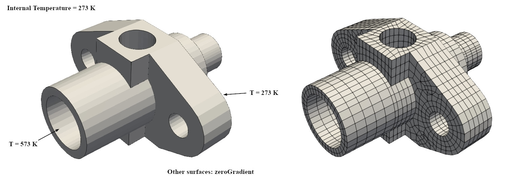
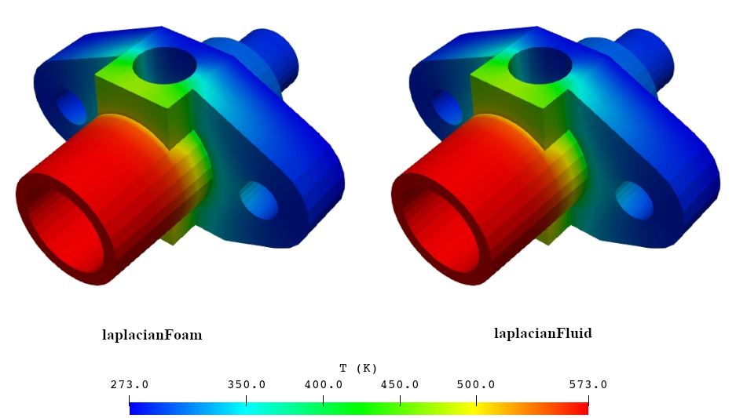
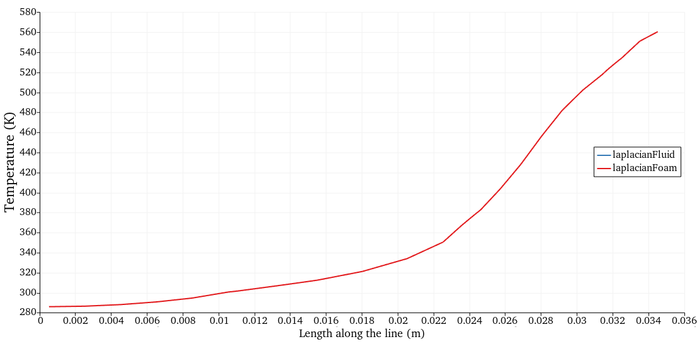

**Repository path:** `tutorials/singleRegion/laplacianFluid/flange`

## Tutorial aims

- Demonstrate how to solve a transient heat-conduction (Laplace/diffusion) problem using the `laplacianFluid` region type.
- Demonstrate how to perform a single-region analysis in multiPhysicsFoam.

## Case Overview


**Case geometry and mesh**

This case computes the transient temperature distribution in a flange. It is the multiPhysicsFoam counterpart of the classic OpenFOAM `laplacianFoam` *flange* tutorial: the same geometry, mesh and boundary conditions are used, but the problem is solved through the multiPhysicsFoam framework using the `laplacianFluid` region type running in *single-region mode*.

The flange is initially at a uniform temperature of 273 K. One face is held at 273 K, while a second face is held at a hot 573 K. The remaining faces are insulated (zero heat flux). Heat then diffuses through the solid geometry over time until a steady linear distribution is approached.

The governing equation is the transient heat-conduction (diffusion) equation for a scalar temperature field $T$:

$$
\frac{\partial T}{\partial t} = \nabla \cdot \left( D_T \, \nabla T \right)
$$

where $D_T$ is the (constant, uniform) thermal diffusivity. There is no convective transport and no source term, so the problem reduces to a pure Laplacian diffusion of $T$.

In `laplacianFluid`, this equation is assembled once per time step and solved implicitly for the temperature field `T`. Because there is only a single region and a single primitive variable, no inter-region coupling or outer PIMPLE iteration is required - the region is *self-coupled* on `T` only:

```pseudocode
for all time-steps
    construct TEqn:  ddt(T) - laplacian(DT, T) == fvOptions(T)
    solve TEqn for T
    if writeTime():
        update derived output: grad(T), DT*grad(T)
end
```

At every write time, `laplacianFluid` also computes and writes four derived fields - the components of $\nabla T$ and the diffusive heat flux $D_T \nabla T$ - mirroring the `write.H` output of the original `laplacianFoam` solver. See Derived Output Fields below.

---
## Case Structure

The case structure follows the typical OpenFOAM case structure:

```plaintext
flangeMP
├── 0
│   └── T
├── Allclean
├── Allrun
├── Allrun-parallel
├── constant
│   ├── polyMesh
│   │   └── …
│   └── transportProperties
└── system
    ├── controlDict
    ├── decomposeParDict
    ├── fvSchemes
    └── fvSolution
```

- `0` - initial and boundary conditions for the primitive field `T`.
- `constant/transportProperties` - the thermal diffusivity `DT`. Only consulted if `0/DT` is not supplied.
- `constant/polyMesh` - the mesh (generated at run time from `flange.ans`).
- `system` - the run-time control (`controlDict`), discretization schemes (`fvSchemes`), linear-solver settings (`fvSolution`) and the parallel decomposition settings (`decomposeParDict`).

Every write time also produces four derived fields alongside `T` and `DT`:
`gradTx`, `gradTy`, `gradTz` and `DTgradT`, e.g.:

```plaintext
3
├── DT
├── DTgradT
├── T
├── gradTx
├── gradTy
├── gradTz
└── uniform
```

The key entries that select the physics are in `system/controlDict`:

```c++
application       multiPhysicsFoam;

singleRegionMode yes;

regionType       laplacianFluid;
```

- `application multiPhysicsFoam`: the executable that is run.
- `singleRegionMode yes`: tells the framework there is only one region occupying the whole domain, so no `constant/regionProperties`/multi-region setup is required.
- `regionType laplacianFluid`: selects the `laplacianFluid` region type at runtime.

---

## Initial Conditions and Boundary Conditions

In this case, there is a single primitive variable:

- temperature (scalar)

```plaintext
├── 0
│   └── T   temperature scalar field
```

The initial temperature field is uniform at 273 K.

### Temperature Field `T`

The `0/T` file sets the internal field and the four patch boundary conditions:

```c++
dimensions      [0 0 0 1 0 0 0];

internalField   uniform 273;

boundaryField
{
    "(patch1|patch3)"
    {
        type            zeroGradient;
    }

    patch2
    {
        type            fixedValue;
        value           uniform 273;
    }

    patch4
    {
        type            fixedValue;
        value           uniform 573;
    }
}
```

- `patch1` and `patch3` use `zeroGradient`, i.e. insulated walls with no heat flux ($\nabla T \cdot \boldsymbol{n} = 0$).
- `patch2` is held at a fixed temperature of 273 K.
- `patch4` is held at a fixed hot temperature of 573 K.

The dimensions `[0 0 0 1 0 0 0]` indicate that `T` is a temperature in kelvin.

### Transport Properties

The only physical property required is the thermal diffusivity `DT`, specified in `constant/transportProperties`:

```c++
DT              4e-05;
```

`DT` has the dimensions of a diffusivity (m²/s). In the solver it is read as a `dimensionedScalar` with `dimViscosity`; if a `DT` field is not present in the time directory, this uniform value is used to construct one.

`constant/transportProperties` is only consulted when `0/DT` is absent, exactly as in `laplacianFoam`. If this case's `0/` directory supplied a `DT` field directly, `transportProperties` would not need to exist at all. The solver checks for `0/DT` first and only falls back to reading `transportProperties` if that check fails.

```note
`DT` is the diffusivity that appears in the `laplacian(DT, T)` term. For a pure heat-conduction problem it corresponds to the thermal diffusivity $\alpha = k / (\rho C_p)$.
```

### Write Control - the `writeGradT` switch

`system/fvSolution` carries one region-specific control, read from the `SIMPLE` subdict:

```c++
SIMPLE
{
    writeGradT      true;
}
```

- `writeGradT true` (the default, used in this case): at every write time, `laplacianFluid` recomputes and writes `gradTx`, `gradTy`, `gradTz` and `DTgradT` alongside `T` - reproducing `laplacianFoam`'s `write.H` output exactly.
- `writeGradT false`: only `T` (and `DT`) are written. No `gradTx`/`gradTy`/`gradTz`/`DTgradT` field objects are even constructed, which is useful in coupled multi-region cases where these four extra fields per write are unwanted overhead.

If the `SIMPLE` subdict or the `writeGradT` entry is absent entirely, the default (`true`) applies.

```note
`laplacianFoam` calls this flux field `flux`. The port renames it to `DTgradT` because `flux` is a generic, collision-prone name in multiPhysicsFoam's shared field registry, where several regions and interfaces may create their own `flux`-like fields on the same mesh.
```

---

## Running the Case

As in all multiPhysicsFoam tutorials, the case is run using the included `Allrun` script, i.e. `> ./Allrun`. In this case, the `Allrun` script is:

```bash
#!/bin/sh
cd "${0%/*}" || exit                                # Run from this directory
. ${WM_PROJECT_DIR:?}/bin/tools/RunFunctions        # Tutorial run functions
#------------------------------------------------------------------------------

restore0Dir

runApplication ansysToFoam \
    ${FOAM_TUTORIALS:?}/resources/geometry/flange.ans -scale 0.001

runApplication $(getApplication)

if true
then
    runApplication foamToEnsight -noZero
    runApplication foamToVTK
fi

#------------------------------------------------------------------------------
```

The script first restores the initial `0` directory, then converts the ANSYS mesh (`flange.ans`) supplied with the OpenFOAM tutorials into the OpenFOAM format using `ansysToFoam` (with a scale factor of 0.001 to convert mm to m). The `$(getApplication)` call reads the `application` entry from `system/controlDict` (here `multiPhysicsFoam`) and runs it. Finally the results are converted to EnSight and VTK formats for post-processing.

```note
This case is run through the `multiPhysicsFoam` solver, not `laplacianFoam`.
The choice of physics is made entirely through the case dictionaries - in particular `regionType laplacianFluid` in `system/controlDict` - so the same executable is used for every multiPhysicsFoam tutorial.
```

---


## Examining the Solver Output

Let us examine the output from the `multiPhysicsFoam` solver for this case.
At start-up, the framework reports the region it has created and the coupling mode:

```plaintext
Creating multi-region system

Creating regions:
Creating region region0: laplacianFluid
Selecting regionType: laplacianFluid

SIMPLE: no convergence criteria found. Calculations will run for 3 steps.

No PIMPLE active

Creating region interfaces:
```

Since this is a single-region case, no region interfaces are created. Each time step then reports the assembly and solution of the temperature equation:

```plaintext
Time = 0.005
Time step = 0.005 Index = 1

Solved region specific physics in 0 s.
Constructing TEqn of laplacianFluid

Solving for T in laplacianFluid
DICPCG:  Solving for T, Initial residual = 1, Final residual = 1.65094e-07, No Iterations 5
Solved self-coupled region equations in 0 s.
ExecutionTime = 0.05 s  ClockTime = 0 s
```

The important lines are:

- `Constructing TEqn of laplacianFluid`: the region type assembles its temperature matrix `TEqn` for this time step.
- `Solving for T in laplacianFluid`: the equation is handed to the linear solver.
- `DICPCG: Solving for T, Initial residual = …, Final residual = …, No Iterations …`: the linear-solver report from the DIC-preconditioned conjugate gradient (PCG) solver selected in `fvSolution`.
- `Solved self-coupled region equations in … s.`: confirms that the region has been solved on its self-coupled field (`T`), with no partitioned inter-region coupling involved.

As the simulation progresses, the initial residual for `T` steadily decreases from `1` towards small values, indicating the temperature field is converging towards its final distribution as heat diffuses through the flange:

```plaintext
Time = 0.01
DICPCG:  Solving for T, Initial residual = 0.20412, Final residual = 3.82655e-07, No Iterations 4

Time = 0.015
DICPCG:  Solving for T, Initial residual = 0.110105, Final residual = 2.15393e-07, No Iterations 4

Time = 0.02
DICPCG:  Solving for T, Initial residual = 0.0728725, Final residual = 1.58276e-07, No Iterations 4
```

## Results (validation):

```note
On this case's tetrahedral, non-orthogonal `flange` mesh, results differ very slightly from plain `laplacianFoam`:
`laplacianFoam` wraps its solve in a `while (simple.correctNonOrthogonal())` loop, but the coupled-matrix solve path used by `laplacianFluid` (`multiRegionSystem::assembleAndSolveEqns`) has no equivalent non-orthogonal corrector loop. The closest available substitute is the Picard corrector (`maxCorr`/`convergenceTolerance` in `fvSolution`), which is not enabled in this tutorial. In practice the discrepancy is negligible for this case - see Results below.
```

Following are the Temperature contour plots and line plots for this case, solved using laplacianFoam and laplacianFluid. As it can be observed, both solutions match, hence validating the correct porting of laplacianFoam to laplacianFluid.



