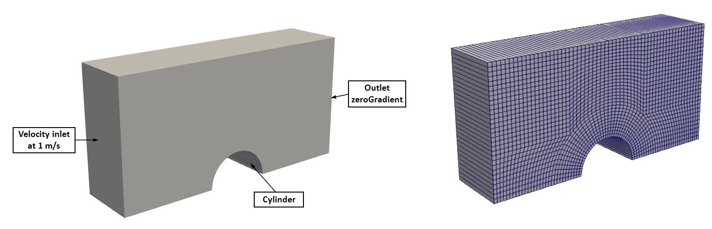
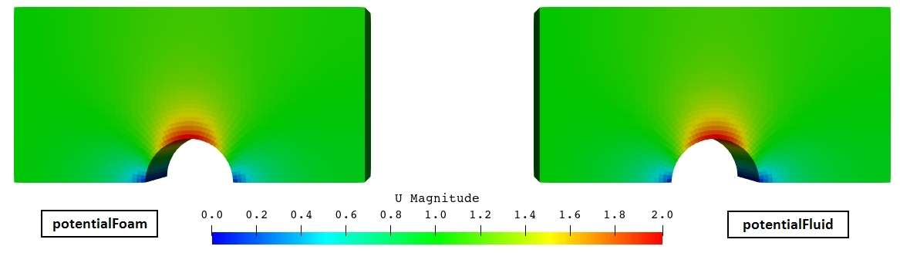
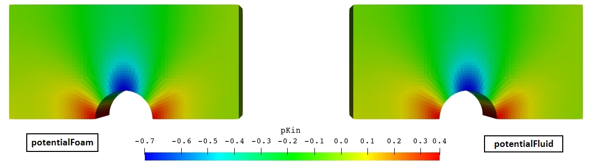
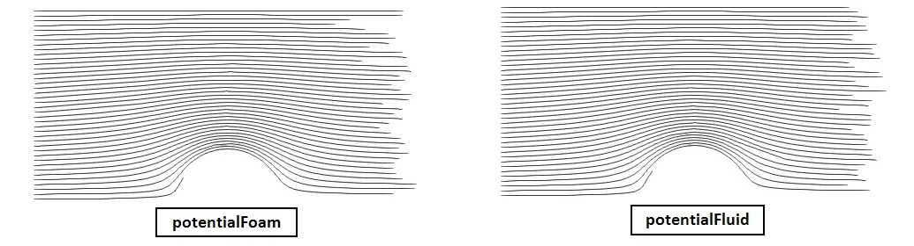

**Repository path:** `tutorials/singleRegion/potentialFluid/cylinder`

## Tutorial aims

- Demonstrate how to solve an inviscid, irrotational potential-flow problem using the `potentialFluid` region type.
- Demonstrate how to perform a single-region analysis in multiPhysicsFoam.
- Demonstrate validation of a region type against a closed-form analytical solution using a `coded` function object.

## Case Overview


**Case geometry and mesh**

This case computes the two-dimensional potential flow past a circular cylinder. It is the multiPhysicsFoam counterpart of the classic OpenFOAM `potentialFoam` *cylinder* tutorial: the same geometry, mesh and boundary conditions are used, but the problem is solved through the multiPhysicsFoam framework using the `potentialFluid` region type running in *single-region mode*.

A cylinder of radius $R = 0.5$ m sits at the origin in a domain spanning $x \in [-2, 2]$ and $y \in [0, 2]$, one cell thick in $z$ (2000 hexahedral cells). Only the upper half of the flow field is modelled; the lower boundary is a symmetry plane through the cylinder axis. A uniform free-stream velocity $U_\infty = 1$ m/s enters from the left.

This geometry is chosen because potential flow past a cylinder has an exact closed-form solution, which makes the case a genuine accuracy check rather than a smoke test.

The governing model assumes the fluid is **incompressible** and **irrotational**:

$$
\nabla \cdot \mathbf{U} = 0
\qquad\qquad
\nabla \times \mathbf{U} = 0
$$

Irrotationality permits the velocity to be written as the gradient of a scalar velocity potential $\Phi$, and substituting into continuity reduces the whole problem to a single Laplace equation:

$$
\mathbf{U} = \nabla \Phi
\qquad \Longrightarrow \qquad
\nabla^2 \Phi = 0
$$

There is no viscosity, no time derivative and no pressure-velocity coupling - the flow is determined entirely by the boundary conditions.

In practice `potentialFluid` does not solve $\nabla^2 \Phi = 0$ literally. It starts from the face-flux field $\phi^{*}$ implied by the boundary conditions alone and removes its divergent part, which is equivalent but guarantees *discrete* continuity on the actual mesh:

$$
\nabla^2 \Phi = \nabla \cdot \phi^{*}
\qquad\text{then}\qquad
\phi = \phi^{*} - \nabla \Phi \cdot \mathbf{S}_f
$$

so that $\nabla \cdot \phi = 0$ to solver tolerance. The cell-centred velocity is then recovered from the corrected fluxes:

```pseudocode
for all time-steps
    make phi relative to MRF zones
    adjustPhi: balance global in/outflow if pKin needs a reference
    for nNonOrthogonalCorrectors + 1 iterations
        construct PhiEqn:  laplacian(Phi) == div(phi)
        setReference(PhiRefCell, PhiRefValue)
        solve PhiEqn for Phi
        if final non-orthogonal iteration:
            phi -= PhiEqn.flux()
    make phi absolute
    report continuity error
    U = reconstruct(phi);  U.correctBoundaryConditions()
    report interpolated velocity error
    if writep:
        construct and solve pKinEqn:  laplacian(pKin) + div(F & div(phi,U)) == 0
    update dimensional pressure p = pKin*rho
end
```

Optionally (`writep`), an approximate pressure field is recovered afterwards by taking the divergence of the steady Euler equation. The source term is filtered along the local flow direction with $\mathbf{F} = \hat{\mathbf{U}} \otimes \hat{\mathbf{U}}$, which retains only the pressure variation *along* streamlines and avoids the excessive swings an unfiltered form produces across regions of strong shear:

$$
\nabla^2 p_\text{kin} + \nabla \cdot \left( \mathbf{F} \cdot \nabla \cdot (\mathbf{U}\mathbf{U}) \right) = 0
$$

```note
`potentialFoam` has no time loop at all - it solves once and exits. multiPhysicsFoam has a real time loop, and `solveRegion()` is therefore called on every time step. The solve is deliberately *not* latched, so this case restricts the run to a single step through `controlDict` (`endTime 1; deltaT 1;`). This reproduces `potentialFoam`'s one-shot behaviour exactly.
```

---
## Case Structure

The case structure follows the typical OpenFOAM case structure:

```plaintext
cylinder
├── 0.orig
│   ├── U
│   └── pKin
├── Allclean
├── Allrun
├── constant
│   ├── polyMesh
│   │   └── …
│   └── transportProperties
└── system
    ├── blockMeshDict
    ├── controlDict
    ├── decomposeParDict
    ├── fvSchemes
    └── fvSolution
```

- `0.orig` - initial and boundary conditions, copied to `0` by `restore0Dir` at the start of `Allrun`.
- `constant/transportProperties` - the fluid density `rho`.
- `constant/polyMesh` - the mesh (generated at run time by `blockMesh`).
- `system` - the run-time control (`controlDict`, which also carries the validation function object), the mesh definition (`blockMeshDict`), discretization schemes (`fvSchemes`), linear-solver and region settings (`fvSolution`) and the parallel decomposition settings (`decomposeParDict`).

The single write time produces the solved fields plus the derived and validation output:

```plaintext
1
├── Phi              velocity potential
├── U                velocity
├── UA               analytical velocity (function object)
├── error            relative error |U-UA|/|UA| (function object)
├── p                dimensional pressure
├── pKin             kinematic pressure
├── phi              volumetric face flux
├── streamFunction   (postProcess)
└── uniform
```

The key entries that select the physics are in `system/controlDict`:

```c++
application       multiPhysicsFoam;

singleRegionMode yes;

regionType       potentialFluid;
```

- `application multiPhysicsFoam`: the executable that is run.
- `singleRegionMode yes`: tells the framework there is only one region occupying the whole domain, so no `constant/multiRegionProperties`/multi-region setup is required.
- `regionType potentialFluid`: selects the `potentialFluid` region type at runtime.

The time controls limit the run to exactly one step:

```c++
endTime          1;
deltaT           1;
writeControl     timeStep;
writeInterval    1;
adjustTimeStep   no;
```

```note
`adjustTimeStep no` is belt-and-braces. `potentialFluid::getMinDeltaT()` returns `GREAT`, which the framework's `setDeltaT.H` already interprets as "this region imposes no time-step constraint", so the step size would not be modified even with adjustment enabled.
```

---

## Initial Conditions and Boundary Conditions

In this case, there are two supplied fields:

```plaintext
├── 0.orig
│   ├── U      velocity vector field
│   └── pKin   kinematic pressure scalar field
```

The initial internal velocity field is uniform at `(0 0 0)`. This is *not* an initial guess in the usual sense - see the note below.

### Velocity Field `U`

```c++
dimensions      [0 1 -1 0 0 0 0];

internalField   uniform (0 0 0);

boundaryField
{
    down
    {
        type            symmetryPlane;
    }

    right
    {
        type            zeroGradient;
    }

    up
    {
        type            symmetryPlane;
    }

    left
    {
        type            uniformFixedValue;
        uniformValue    constant (1 0 0);
    }

    cylinder
    {
        type            symmetry;
    }

    defaultFaces
    {
        type            empty;
    }
}
```

- `left` is the inlet, holding a uniform free-stream velocity of 1 m/s in $+x$.
- `right` is the outlet, using `zeroGradient` so the velocity is free to develop.
- `down` (the axis through the cylinder) and `up` (the far field) are `symmetryPlane`.
- `cylinder` is the cylinder surface, using `symmetry`.
- `defaultFaces` collects the front and back planes, `empty` for a 2D case.

```note
The cylinder surface is `symmetry`, not `noSlip`. This is the correct wall condition for potential flow: a symmetry condition enforces zero *normal* flux while leaving the tangential velocity free, which is exactly the inviscid slip-wall behaviour. A no-slip condition would impose a boundary layer that this model cannot represent.
```

```note
`potentialFluid` zeroes `U`'s internal field in its constructor, so the `internalField uniform (0 0 0)` entry above is not really an initial condition - only the boundary conditions of `U` matter. The potential-flow solution is fully determined by them, so any interior guess is discarded. Note that the constructor also assigns zero to the boundary field, but `fixedValueFvPatchField::operator=` is a no-op, so the prescribed inlet value survives.
```

### Kinematic Pressure Field `pKin`

```c++
dimensions      [0 2 -2 0 0 0 0];

internalField   uniform 0;

boundaryField
{
    down
    {
        type            symmetryPlane;
    }

    right
    {
        type            fixedValue;
        value           uniform 0;
    }

    up
    {
        type            symmetryPlane;
    }

    left
    {
        type            zeroGradient;
    }

    cylinder
    {
        type            symmetry;
    }

    defaultFaces
    {
        type            empty;
    }
}
```

Note that `pKin` is the mirror image of `U`: wherever `U` fixes a value (`left`), `pKin` is `zeroGradient`; wherever `U` is free (`right`), `pKin` is `fixedValue`. This is physically necessary - you cannot independently impose both velocity and pressure at the same boundary.

The dimensions `[0 2 -2 0 0 0 0]` (m²/s²) indicate that `pKin` is a *kinematic* pressure, i.e. $p/\rho$.

```note
In `potentialFoam` this field is simply called `p`. The port renames it to `pKin` to follow the multiPhysicsFoam convention (as in `pimpleFluid`), reserving the name `p` for the dimensional pressure. One consequence: `setRefCell` derives its dictionary keywords from the field name, so this case uses `pKinRefCell`/`pKinRefValue`, not `pRefCell`/`pRefValue`.
```

Supplying `0/pKin` is in fact optional. If it is absent, `potentialFluid` constructs it with boundary types inferred from `U` by exactly the inversion described above, and then infers `Phi`'s boundary types from `pKin` by inverting again. Supplying `0/U` alone is sufficient.

### Transport Properties

The only physical property required is the density `rho`, specified in `constant/transportProperties`:

```c++
rho             1000;
```

`rho` is read as a `dimensionedScalar` with `dimDensity`, so the bare number above is interpreted as kg/m³ (dimensions are supplied in code).

```note
Density plays no part in the potential-flow solution, which is purely kinematic. It is used only to form the dimensional pressure field (p = pKin * rho) that sibling regions expect. `constant/transportProperties` is nevertheless mandatory - it is read `MUST_READ`, and the region will abort without it. This is a difference from stock `potentialFoam`, whose tutorials contain no `transportProperties` file at all.
```

### Region Controls - the `potentialFlow` subdict

`system/fvSolution` carries the linear solvers and the region-specific controls:

```c++
solvers
{
    Phi
    {
        solver          GAMG;
        smoother        DIC;
        tolerance       1e-06;
        relTol          0.01;
    }

    pKin
    {
        $Phi;
    }
}

potentialFlow
{
    nNonOrthogonalCorrectors 3;

    writePhi        true;
    writep          true;
}
```

`potentialFoam` is a standalone executable and exposes its options as command-line flags. A region type cannot take command-line arguments, so these become optional entries in the `potentialFlow` subdict, all read as `Foam::Switch` and defaulting to `false`:

| Entry | Upstream flag | Effect |
|-------|---------------|--------|
| `initialiseUBCs` | `-initialiseUBCs` | Call `U.correctBoundaryConditions()` and rebuild `phi` before solving. Needed when a boundary condition computes its value from other fields. |
| `writePhi` | `-writePhi` | AUTO_WRITE the velocity potential `Phi` |
| `writep` | `-writep` | **Calculate** the approximate Euler pressure |

Being `Switch`-valued, each accepts `true`/`false`, `yes`/`no` or `on`/`off`.

```note
`writep` gates the *calculation*, not the writing. `U`, `phi`, `pKin` and `p` are all AUTO_WRITE unconditionally, because they are primary fields shared with sibling regions on the same mesh and must be writable whichever region owns them. A consequence worth knowing: with `writep false`, `pKin` and `p` are still written, but as zero, because the Euler pressure was never computed. The upstream `-writephi` flag has no equivalent at all - `phi` is always written.
```

`nNonOrthogonalCorrectors 3` means the $\Phi$ equation is assembled and solved four times. The implicit Laplacian only captures the face-normal part of the gradient; on a non-orthogonal mesh the remainder is added explicitly and therefore lags, so the equation is re-solved until it settles. The flux correction `phi -= PhiEqn.flux()` is applied only on the final iteration.

### Validation Function Object

`system/controlDict` carries a `coded` function object that computes the exact solution and the resulting error field at the end of the run:

```c++
functions
{
    error
    {
        name    error;
        type    coded;
        libs    (utilityFunctionObjects);

        codeEnd
        #{
            …
        #};
    }
}
```

It reads the free-stream velocity from the `left` patch and the cylinder radius from the `cylinder` patch, evaluates the analytical potential-flow solution for flow past a cylinder,

$$
\mathbf{U}_A = U_\infty \left[ \hat{\mathbf{x}} - \left(\frac{R}{r}\right)^2 \left( \cos 2\theta \, \hat{\mathbf{x}} + \sin 2\theta \, \hat{\mathbf{y}} \right) \right]
$$

and writes it as `UA`, together with the relative error field

$$
\text{error} = \frac{|\mathbf{U} - \mathbf{U}_A|}{|\mathbf{U}_A|}
$$

---

## Running the Case

As in all multiPhysicsFoam tutorials, the case is run using the included `Allrun` script, i.e. `> ./Allrun`. In this case, the `Allrun` script is:

```bash
#!/bin/sh
cd "${0%/*}" || exit                                # Run from this directory
. ${WM_PROJECT_DIR:?}/bin/tools/RunFunctions        # Tutorial run functions
#------------------------------------------------------------------------------

canCompile || exit 0    # Dynamic code

restore0Dir

runApplication blockMesh

runApplication $(getApplication)

runApplication postProcess -func streamFunction -latestTime

#------------------------------------------------------------------------------
```

The `canCompile` guard skips the case on installations that cannot compile dynamic code, which both the `#codeStream` entries in `blockMeshDict` and the validation function object require. The script then restores the initial `0` directory, generates the mesh with `blockMesh`, and runs the solver. The `$(getApplication)` call reads the `application` entry from `system/controlDict` (here `multiPhysicsFoam`) and runs it. Finally `postProcess` computes the stream function from the solved flux field, which is convenient for visualising streamlines.

```note
The upstream `potentialFoam` version of this script passes options on the command line: `potentialFoam -withFunctionObjects -writePhi -writephi -writep`. All of these are gone here - the write/calculate switches moved into the `potentialFlow` dict, and `-withFunctionObjects` is unnecessary because the framework has a real time loop that executes function objects automatically.
```

```note
`-latestTime` is passed to `postProcess` deliberately. Without it, `postProcess` also visits time 0, which contains only `U` and `pKin` and no `phi`, and reports a spurious `Field phi not found` / `failed to execute` warning before succeeding at time 1. This is an artefact of the framework advancing time (0 → 1) where `potentialFoam` wrote everything into `0`.
```

```note
This case is run through the `multiPhysicsFoam` solver, not `potentialFoam`.
The choice of physics is made entirely through the case dictionaries - in particular `regionType potentialFluid` in `system/controlDict` - so the same executable is used for every multiPhysicsFoam tutorial.
```

---


## Examining the Solver Output

Let us examine the output from the `multiPhysicsFoam` solver for this case.
At start-up, the framework reports the region it has created and the coupling mode:

```plaintext
Creating multi-region system

Creating regions:
Creating region region0: potentialFluid
Selecting regionType: potentialFluid

potentialFlow: Operating solver in PISO mode

No MRF models present

No PIMPLE active

Creating region interfaces:
```

- `potentialFlow: Operating solver in PISO mode`: `potentialFluid` constructs a `pisoControl` named `potentialFlow`, exactly as `potentialFoam` does. It is used only for its non-orthogonal corrector loop and its dictionary access - no PISO pressure-velocity iteration takes place.
- `No MRF models present`: no `constant/MRFProperties` was supplied.
- `No PIMPLE active`: `potentialFluid::usesPIMPLE()` returns `false`, so the framework skips the PIMPLE stage entirely.

Since this is a single-region case, no region interfaces are created. The single time step then reports the potential-flow solution:

```plaintext
Time = 1
Time step = 1 Index = 1


Calculating potential flow in region region0
GAMG:  Solving for Phi, Initial residual = 1, Final residual = 0.00645988, No Iterations 5
GAMG:  Solving for Phi, Initial residual = 0.0126268, Final residual = 6.6182e-05, No Iterations 4
GAMG:  Solving for Phi, Initial residual = 0.00260623, Final residual = 2.0189e-05, No Iterations 3
GAMG:  Solving for Phi, Initial residual = 0.000910968, Final residual = 3.41138e-06, No Iterations 4
Continuity error = 0.000135471
Interpolated velocity error = 1.18729e-05
```

The important lines are:

- `Calculating potential flow in region region0`: the region announces its solve. The region name is `region0`, the default single-region mesh name.
- Four `GAMG: Solving for Phi` reports - one per non-orthogonal corrector iteration (`nNonOrthogonalCorrectors 3` plus the initial solve). The initial residual falls from `1` to `9.1e-04` across the loop, showing the explicit non-orthogonal contribution converging.
- `Continuity error = 1.35e-04`: the volume-weighted average of $|\nabla \cdot \phi|$ after the flux correction. This is the primary measure of whether the projection succeeded.
- `Interpolated velocity error = 1.19e-05`: the drift between `fvc::flux(U)` and `phi` after reconstruction. This is a **mesh-quality diagnostic** - reconstruction from face fluxes to cell centres is lossy on skewed or non-orthogonal meshes, so a large value here indicts the mesh rather than the solver.

Because `writep true`, the approximate Euler pressure is then solved in its own non-orthogonal loop:

```plaintext
Calculating approximate pressure field
GAMG:  Solving for pKin, Initial residual = 1, Final residual = 0.0044911, No Iterations 4
GAMG:  Solving for pKin, Initial residual = 0.0634728, Final residual = 0.000267827, No Iterations 5
GAMG:  Solving for pKin, Initial residual = 0.0126467, Final residual = 8.64168e-05, No Iterations 3
GAMG:  Solving for pKin, Initial residual = 0.00399408, Final residual = 3.30476e-05, No Iterations 4
Solved region specific physics in 0.01 s.
ExecutionTime = 0.06 s  ClockTime = 21 s
```

- `Solved region specific physics in … s.`: confirms the work was done in `solveRegion()`, the framework stage for region-local physics, rather than in the PIMPLE or self-coupled paths.

Finally the validation function object runs and reports what it found:

```plaintext
Looking up field U

Reading inlet velocity uInfX

U at inlet = 1 m/s
Cylinder radius = 0.499614 m

Evaluating analytical solution
Writing relative error in U to ".../cylinder/1/error"
End
```

The reported radius of 0.499614 m rather than exactly 0.5 m is the discrete polygonal approximation of the cylinder on this mesh, measured at the first face centre of the `cylinder` patch.

## Results (validation):

This case reproduces stock `potentialFoam` **exactly**. Running the upstream `$FOAM_TUTORIALS/basic/potentialFoam/cylinder` case and comparing every written field, after stripping the `FoamFile` headers, gives byte-identical results:

| Field | `potentialFoam` | `potentialFluid` | Result |
|-------|-----------------|------------------|--------|
| `U` | `0/U` | `1/U` | identical |
| `phi` | `0/phi` | `1/phi` | identical |
| `Phi` | `0/Phi` | `1/Phi` | identical |
| kinematic pressure | `0/p` | `1/pKin` | identical |
| `streamFunction` | `0/streamFunction` | `1/streamFunction` | identical |
| `UA` | `0/UA` | `1/UA` | identical |
| `error` | `0/error` | `1/error` | identical |

The printed diagnostics agree to every digit:

| Diagnostic | `potentialFoam` | `potentialFluid` |
|------------|-----------------|------------------|
| Continuity error | 0.000135471 | 0.000135471 |
| Interpolated velocity error | 1.18729e-05 | 1.18729e-05 |

Against the analytical solution, the relative error field over the 2000 cells is:

| Metric | Value |
|--------|-------|
| Maximum relative error | 9.14e-02 |
| Mean relative error | 5.36e-02 |

This residual discrepancy is **discretisation error on a coarse mesh**, not a porting defect - upstream `potentialFoam` produces exactly the same `error` field on the same mesh. It is largest near the cylinder surface, where the polygonal approximation of the circular boundary is least accurate.





