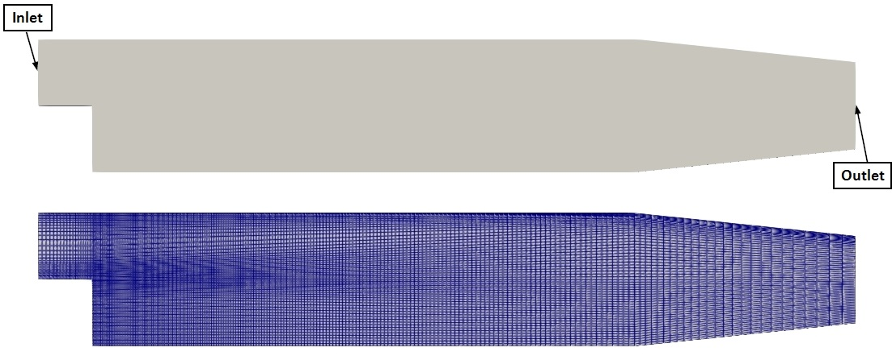
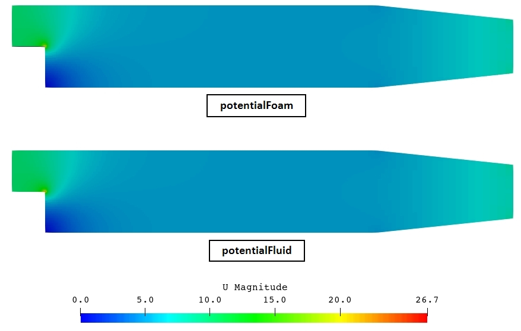
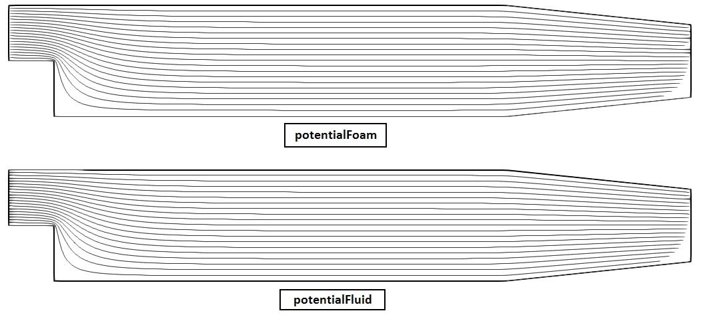

**Repository path:** `tutorials/singleRegion/potentialFluid/pitzDaily`

## Tutorial aims

- Demonstrate how to solve an inviscid, irrotational potential-flow problem using the `potentialFluid` region type.
- Demonstrate how to perform a single-region analysis in multiPhysicsFoam.
- Demonstrate the use of `potentialFluid` as an *initialiser* that generates a divergence-free starting field for a subsequent Navier-Stokes run.
- Illustrate, by construction, the physical limits of the potential-flow model.

## Case Overview


**Case geometry and mesh**

This case computes the two-dimensional potential flow through the Pitz-Daily backward-facing step geometry. It is the multiPhysicsFoam counterpart of the OpenFOAM `potentialFoam` *pitzDaily* tutorial: the same geometry, mesh and boundary conditions are used, but the problem is solved through the multiPhysicsFoam framework using the `potentialFluid` region type running in *single-region mode*.

The geometry is a sudden expansion followed by a contracting nozzle, meshed with 12225 hexahedral cells one cell thick in $z$ (the `blockMeshDict` is specified in millimetres and scaled by 0.001). A uniform velocity of 10 m/s enters at the inlet upstream of the step.

The same mesh is used by the `pimpleFluid` pitzDaily tutorial, which makes this case a natural demonstration of the initialiser workflow: the potential-flow field computed here is a valid, discretely divergence-free starting point for a full turbulent Navier-Stokes solve on the same grid.

The governing model assumes the fluid is **incompressible** and **irrotational**:

$$
\nabla \cdot \mathbf{U} = 0
\qquad\qquad
\nabla \times \mathbf{U} = 0
$$

Irrotationality permits the velocity to be written as the gradient of a scalar velocity potential $\Phi$, and substituting into continuity reduces the whole problem to a single Laplace equation:

$$
\mathbf{U} = \nabla \Phi
\qquad \Longrightarrow \qquad
\nabla^2 \Phi = 0
$$

There is no viscosity, no time derivative and no pressure-velocity coupling - the flow is determined entirely by the boundary conditions.

In practice `potentialFluid` does not solve $\nabla^2 \Phi = 0$ literally. It starts from the face-flux field $\phi^{*}$ implied by the boundary conditions alone and removes its divergent part, which is equivalent but guarantees *discrete* continuity on the actual mesh:

$$
\nabla^2 \Phi = \nabla \cdot \phi^{*}
\qquad\text{then}\qquad
\phi = \phi^{*} - \nabla \Phi \cdot \mathbf{S}_f
$$

so that $\nabla \cdot \phi = 0$ to solver tolerance. The cell-centred velocity is then recovered from the corrected fluxes:

```pseudocode
for all time-steps
    make phi relative to MRF zones
    adjustPhi: balance global in/outflow if pKin needs a reference
    for nNonOrthogonalCorrectors + 1 iterations
        construct PhiEqn:  laplacian(Phi) == div(phi)
        setReference(PhiRefCell, PhiRefValue)
        solve PhiEqn for Phi
        if final non-orthogonal iteration:
            phi -= PhiEqn.flux()
    make phi absolute
    report continuity error
    U = reconstruct(phi);  U.correctBoundaryConditions()
    report interpolated velocity error
    if writep:
        construct and solve pKinEqn:  laplacian(pKin) + div(F & div(phi,U)) == 0
    update dimensional pressure p = pKin*rho
end
```

```warning
This case does not model the real physics of a backward-facing step. The defining feature of the Pitz-Daily flow is the recirculation zone behind the step, which is produced by viscous separation. Potential flow has no viscosity, so the computed solution turns the corner cleanly with no separation, no recirculation and no wake. That is not a defect in the case - it is what the model says. The case is included as a smoke test and as an initialiser demonstration, and it is a useful illustration of exactly what potential flow leaves out.
```

```note
`potentialFoam` has no time loop at all - it solves once and exits. multiPhysicsFoam has a real time loop, and `solveRegion()` is therefore called on every time step. The solve is deliberately *not* latched, so this case restricts the run to a single step through `controlDict` (`endTime 1; deltaT 1;`). This reproduces `potentialFoam`'s one-shot behaviour exactly.
```

---
## Case Structure

The case structure follows the typical OpenFOAM case structure:

```plaintext
pitzDaily
├── 0.orig
│   ├── U
│   └── pKin
├── Allclean
├── Allrun
├── constant
│   ├── polyMesh
│   │   └── …
│   └── transportProperties
└── system
    ├── blockMeshDict
    ├── controlDict
    ├── fvSchemes
    └── fvSolution
```

- `0.orig` - initial and boundary conditions, copied to `0` by `restore0Dir` at the start of `Allrun`.
- `constant/transportProperties` - the fluid density `rho`.
- `constant/polyMesh` - the mesh (generated at run time by `blockMesh`).
- `system` - the run-time control (`controlDict`), the mesh definition (`blockMeshDict`), discretization schemes (`fvSchemes`) and linear-solver and region settings (`fvSolution`).

The single write time produces:

```plaintext
1
├── Phi              velocity potential
├── U                velocity
├── p                dimensional pressure
├── pKin             kinematic pressure
├── phi              volumetric face flux
├── streamFunction   (postProcess)
└── uniform
```

The key entries that select the physics are in `system/controlDict`:

```c++
application       multiPhysicsFoam;

singleRegionMode yes;

regionType       potentialFluid;
```

- `application multiPhysicsFoam`: the executable that is run.
- `singleRegionMode yes`: tells the framework there is only one region occupying the whole domain, so no `constant/multiRegionProperties`/multi-region setup is required.
- `regionType potentialFluid`: selects the `potentialFluid` region type at runtime.

The time controls limit the run to exactly one step:

```c++
endTime          1;
deltaT           1;
writeControl     timeStep;
writeInterval    1;
adjustTimeStep   no;
```

```note
`adjustTimeStep no` is belt-and-braces. `potentialFluid::getMinDeltaT()` returns `GREAT`, which the framework's `setDeltaT.H` already interprets as "this region imposes no time-step constraint", so the step size would not be modified even with adjustment enabled.
```

---

## Initial Conditions and Boundary Conditions

In this case, there are two supplied fields:

```plaintext
├── 0.orig
│   ├── U      velocity vector field
│   └── pKin   kinematic pressure scalar field
```

### Velocity Field `U`

```c++
dimensions      [0 1 -1 0 0 0 0];

internalField   uniform (0 0 0);

boundaryField
{
    inlet
    {
        type            fixedValue;
        value           uniform (10 0 0);
    }

    outlet
    {
        type            zeroGradient;
    }

    upperWall
    {
        type            noSlip;
    }

    lowerWall
    {
        type            noSlip;
    }

    frontAndBack
    {
        type            empty;
    }
}
```

- `inlet` holds a uniform 10 m/s in $+x$.
- `outlet` uses `zeroGradient` so the velocity is free to develop.
- `upperWall` and `lowerWall` are `noSlip`.
- `frontAndBack` is `empty` for a 2D case.

```note
`noSlip` on the walls may look inconsistent with an inviscid model, and in a sense it is - but it produces the correct behaviour here. `noSlip` is a `fixedValue` condition, so the boundary-condition inference chain makes `pKin` `zeroGradient` on those patches and `Phi` `zeroGradient` in turn, which enforces zero flux through the wall. Since the velocity is reconstructed from the corrected fluxes rather than taken from the supplied field, the walls behave as impermeable slip walls, which is exactly the potential-flow wall condition. The `cylinder` tutorial expresses the same intent more directly using `symmetry`.
```

```note
`potentialFluid` zeroes `U`'s internal field in its constructor, so the `internalField uniform (0 0 0)` entry above is not really an initial condition - only the boundary conditions of `U` matter. The potential-flow solution is fully determined by them, so any interior guess is discarded. Note that the constructor also assigns zero to the boundary field, but `fixedValueFvPatchField::operator=` is a no-op, so the prescribed inlet value survives.
```

### Kinematic Pressure Field `pKin`

```c++
dimensions      [0 2 -2 0 0 0 0];

internalField   uniform 0;

boundaryField
{
    inlet
    {
        type            zeroGradient;
    }

    outlet
    {
        type            fixedValue;
        value           uniform 0;
    }

    upperWall
    {
        type            zeroGradient;
    }

    lowerWall
    {
        type            zeroGradient;
    }

    frontAndBack
    {
        type            empty;
    }
}
```

Note that `pKin` is the mirror image of `U`: wherever `U` fixes a value (`inlet`, the walls), `pKin` is `zeroGradient`; wherever `U` is free (`outlet`), `pKin` is `fixedValue`. This is physically necessary - you cannot independently impose both velocity and pressure at the same boundary.

The dimensions `[0 2 -2 0 0 0 0]` (m²/s²) indicate that `pKin` is a *kinematic* pressure, i.e. $p/\rho$.

```note
In `potentialFoam` this field is simply called `p`. The port renames it to `pKin` to follow the multiPhysicsFoam convention (as in `pimpleFluid`), reserving the name `p` for the dimensional pressure. One consequence: `setRefCell` derives its dictionary keywords from the field name, so this case would use `pKinRefCell`/`pKinRefValue`, not `pRefCell`/`pRefValue`. Neither is needed here, because the fixed-value `outlet` already anchors the pressure.
```

Supplying `0/pKin` is in fact optional. If it is absent, `potentialFluid` constructs it with boundary types inferred from `U` by exactly the inversion described above, and then infers `Phi`'s boundary types from `pKin` by inverting again. Supplying `0/U` alone is sufficient.

### Transport Properties

The only physical property required is the density `rho`, specified in `constant/transportProperties`:

```c++
rho             1000;
```

`rho` is read as a `dimensionedScalar` with `dimDensity`, so the bare number above is interpreted as kg/m³ (dimensions are supplied in code).

```note
Density plays no part in the potential-flow solution, which is purely kinematic. It is used only to form the dimensional pressure field (p = pKin * rho) that sibling regions expect. `constant/transportProperties` is nevertheless mandatory - it is read `MUST_READ`, and the region will abort without it. This is a difference from stock `potentialFoam`, whose tutorials contain no `transportProperties` file at all.
```

### Region Controls - the `potentialFlow` subdict

`system/fvSolution` carries the linear solvers and the region-specific controls:

```c++
solvers
{
    Phi
    {
        solver          GAMG;
        smoother        DIC;
        tolerance       1e-06;
        relTol          0.01;
    }

    pKin
    {
        $Phi;
    }
}

potentialFlow
{
    nNonOrthogonalCorrectors 2;

    writePhi        true;
    writep          true;
}
```

`potentialFoam` is a standalone executable and exposes its options as command-line flags. A region type cannot take command-line arguments, so these become optional entries in the `potentialFlow` subdict, all read as `Foam::Switch` and defaulting to `false`:

| Entry | Upstream flag | Effect |
|-------|---------------|--------|
| `initialiseUBCs` | `-initialiseUBCs` | Call `U.correctBoundaryConditions()` and rebuild `phi` before solving. Needed when a boundary condition computes its value from other fields. |
| `writePhi` | `-writePhi` | AUTO_WRITE the velocity potential `Phi` |
| `writep` | `-writep` | **Calculate** the approximate Euler pressure |

Being `Switch`-valued, each accepts `true`/`false`, `yes`/`no` or `on`/`off`.

```note
`writep` gates the *calculation*, not the writing. `U`, `phi`, `pKin` and `p` are all AUTO_WRITE unconditionally, because they are primary fields shared with sibling regions on the same mesh and must be writable whichever region owns them. A consequence worth knowing: with `writep false`, `pKin` and `p` are still written, but as zero, because the Euler pressure was never computed. The upstream `-writephi` flag has no equivalent at all - `phi` is always written.
```

`nNonOrthogonalCorrectors 2` means the $\Phi$ equation is assembled and solved three times. The implicit Laplacian only captures the face-normal part of the gradient; on a non-orthogonal mesh the remainder is added explicitly and therefore lags, so the equation is re-solved until it settles. The flux correction `phi -= PhiEqn.flux()` is applied only on the final iteration. This mesh is graded and moderately non-orthogonal, which is why correctors are needed at all.

---

## Running the Case

As in all multiPhysicsFoam tutorials, the case is run using the included `Allrun` script, i.e. `> ./Allrun`. In this case, the `Allrun` script is:

```bash
#!/bin/sh
cd "${0%/*}" || exit                                # Run from this directory
. ${WM_PROJECT_DIR:?}/bin/tools/RunFunctions        # Tutorial run functions
#------------------------------------------------------------------------------

restore0Dir

runApplication blockMesh

runApplication $(getApplication)

runApplication postProcess -func streamFunction -latestTime

#------------------------------------------------------------------------------
```

The script restores the initial `0` directory, generates the mesh with `blockMesh`, and runs the solver. The `$(getApplication)` call reads the `application` entry from `system/controlDict` (here `multiPhysicsFoam`) and runs it. Finally `postProcess` computes the stream function from the solved flux field, which is convenient for visualising streamlines.

```note
The upstream `potentialFoam` version of this script passes options on the command line: `potentialFoam -writePhi -writephi -writep`. All of these are gone here - the write/calculate switches moved into the `potentialFlow` dict.
```

```note
`-latestTime` is passed to `postProcess` deliberately. Without it, `postProcess` also visits time 0, which contains only `U` and `pKin` and no `phi`, and reports a spurious `Field phi not found` / `failed to execute` warning before succeeding at time 1. This is an artefact of the framework advancing time (0 → 1) where `potentialFoam` wrote everything into `0`.
```

```note
This case is run through the `multiPhysicsFoam` solver, not `potentialFoam`.
The choice of physics is made entirely through the case dictionaries - in particular `regionType potentialFluid` in `system/controlDict` - so the same executable is used for every multiPhysicsFoam tutorial.
```

Unlike the `cylinder` case, this one needs no `canCompile` guard - there is no dynamic code in either the mesh definition or the function objects.

---


## Examining the Solver Output

Let us examine the output from the `multiPhysicsFoam` solver for this case.
At start-up, the framework reports the region it has created and the coupling mode:

```plaintext
Creating multi-region system

Creating regions:
Creating region region0: potentialFluid
Selecting regionType: potentialFluid

potentialFlow: Operating solver in PISO mode

No MRF models present

No PIMPLE active

Creating region interfaces:
```

- `potentialFlow: Operating solver in PISO mode`: `potentialFluid` constructs a `pisoControl` named `potentialFlow`, exactly as `potentialFoam` does. It is used only for its non-orthogonal corrector loop and its dictionary access - no PISO pressure-velocity iteration takes place.
- `No MRF models present`: no `constant/MRFProperties` was supplied.
- `No PIMPLE active`: `potentialFluid::usesPIMPLE()` returns `false`, so the framework skips the PIMPLE stage entirely.

Since this is a single-region case, no region interfaces are created. The single time step then reports the potential-flow solution:

```plaintext
Time = 1
Time step = 1 Index = 1


Calculating potential flow in region region0
GAMG:  Solving for Phi, Initial residual = 1, Final residual = 0.00961922, No Iterations 14
GAMG:  Solving for Phi, Initial residual = 0.0117848, Final residual = 6.83576e-05, No Iterations 5
GAMG:  Solving for Phi, Initial residual = 0.000243718, Final residual = 1.35614e-06, No Iterations 9
Continuity error = 0.00269801
Interpolated velocity error = 0.000114117
```

The important lines are:

- `Calculating potential flow in region region0`: the region announces its solve. The region name is `region0`, the default single-region mesh name.
- Three `GAMG: Solving for Phi` reports - one per non-orthogonal corrector iteration (`nNonOrthogonalCorrectors 2` plus the initial solve). The initial residual falls from `1` to `2.4e-04` across the loop, showing the explicit non-orthogonal contribution converging.
- `Continuity error = 2.70e-03`: the volume-weighted average of $|\nabla \cdot \phi|$ after the flux correction. This is the primary measure of whether the projection succeeded. It is roughly twenty times larger than in the `cylinder` case, reflecting this mesh's grading and higher non-orthogonality together with the much larger velocity scale (10 m/s rather than 1 m/s).
- `Interpolated velocity error = 1.14e-04`: the drift between `fvc::flux(U)` and `phi` after reconstruction. This is a **mesh-quality diagnostic** - reconstruction from face fluxes to cell centres is lossy on skewed or non-orthogonal meshes, so a large value here indicts the mesh rather than the solver.

Because `writep true`, the approximate Euler pressure is then solved in its own non-orthogonal loop:

```plaintext
Calculating approximate pressure field
GAMG:  Solving for pKin, Initial residual = 1, Final residual = 0.0082346, No Iterations 5
GAMG:  Solving for pKin, Initial residual = 0.0122468, Final residual = 0.000101844, No Iterations 5
GAMG:  Solving for pKin, Initial residual = 0.000410741, Final residual = 3.99708e-06, No Iterations 6
Solved region specific physics in 0.13 s.
ExecutionTime = 0.35 s  ClockTime = 1 s
```

- `Solved region specific physics in … s.`: confirms the work was done in `solveRegion()`, the framework stage for region-local physics, rather than in the PIMPLE or self-coupled paths.

## Results (validation):

This case reproduces stock `potentialFoam` **exactly**. Running the upstream `$FOAM_TUTORIALS/basic/potentialFoam/pitzDaily` case and comparing every written field, after stripping the `FoamFile` headers, gives byte-identical results:

| Field | `potentialFoam` | `potentialFluid` | Result |
|-------|-----------------|------------------|--------|
| `U` | `0/U` | `1/U` | identical |
| `phi` | `0/phi` | `1/phi` | identical |
| `Phi` | `0/Phi` | `1/Phi` | identical |
| kinematic pressure | `0/p` | `1/pKin` | identical |
| `streamFunction` | `0/streamFunction` | `1/streamFunction` | identical |

The printed diagnostics agree to every digit:

| Diagnostic | `potentialFoam` | `potentialFluid` |
|------------|-----------------|------------------|
| Continuity error | 0.00269801 | 0.00269801 |
| Interpolated velocity error | 0.000114117 | 0.000114117 |

The additional field `p` has no upstream counterpart - it is the dimensional pressure maintained by `potentialFluid` for multi-region compatibility. It was verified to equal $p_\text{kin} \times \rho$ exactly in every one of the 12225 cells, with dimensions `[1 -1 -2 0 0 0 0]` (Pa).

```note
There is no analytical solution to validate against for this geometry, unlike the `cylinder` case. Validation here is by exact reproduction of the reference solver only. For an accuracy check against a known closed-form result, see `potentialFluid_tutorial_cylinder.md`.
```




