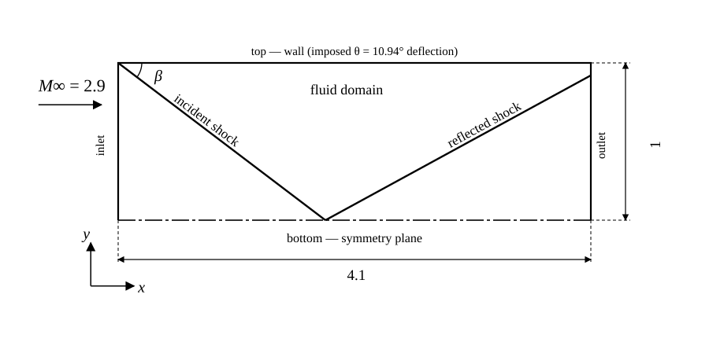
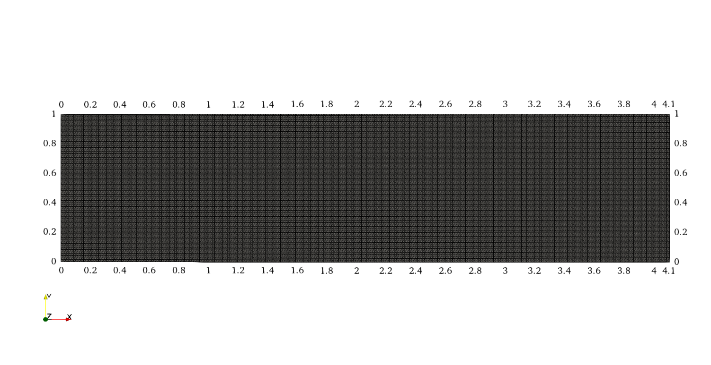
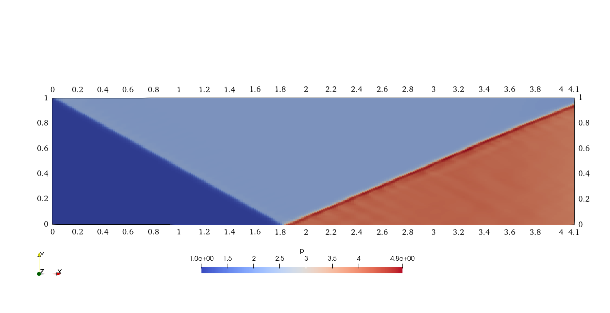
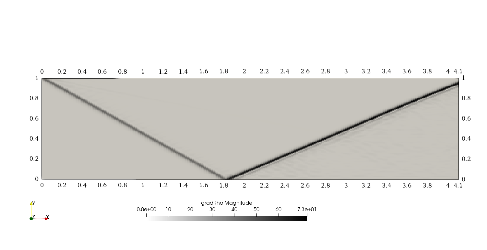

**Repository path:** `tutorials/singleRegion/rhoPimpleFluid/obliqueShock`

## Tutorial aims

- Demonstrate how to run `rhoPimpleFluid` in *single-region mode* on a compressible, supersonic problem with a standing shock.
- Demonstrate local time stepping (LTS, the `localEuler` `ddt` scheme) as a pseudo-transient path to a steady-state solution.
- Demonstrate a `transonic yes` PIMPLE setup and the associated pressure-limiting controls (`pMin`/`pMax`).
- Validate the region type's predicted pressure, temperature and velocity jump across an oblique shock against classical θ-β-M shock theory.

## Case Overview


**Case geometry and mesh: a 4.1 × 1 rectangular domain, 240 × 120 cells, with the wedge deflection imposed as a boundary condition on the `top` patch rather than meshed as a physical wedge.**

This case computes the steady oblique shock produced when a Mach 2.9 supersonic stream is deflected by 10.94°. It is the multiPhysicsFoam counterpart of the stock OpenFOAM `rhoCentralFoam` *obliqueShock* tutorial: the same domain, mesh topology and boundary values are reused, but the problem is solved through the multiPhysicsFoam framework using the `rhoPimpleFluid` region type running in *single-region mode*, marched to steady state with local time stepping instead of `rhoCentralFoam`'s explicit density-based time integration.

Rather than meshing a physical wedge, the deflection is imposed directly as a boundary condition: the `top` patch (declared `type wall` in `blockMeshDict`) carries `fixedValue` conditions on `U` and `T` corresponding to the post-deflection state, while `p` on `top` is left `zeroGradient` — the post-shock pressure is therefore a genuine prediction of the solver, not an imposed value, which is what makes this case a validation case rather than a demonstration.

| Patch | Type | Role |
|-------|------|------|
| `inlet` | `patch` | Supersonic inflow, $M = 2.9$ |
| `top` | `wall` | Imposed deflected-flow wall (`fixedValue` `U`, `T`; `zeroGradient` `p`) — represents the wedge |
| `bottom` | `symmetryPlane` | Flow symmetry axis; the incident shock reflects here |
| `outlet` | `patch` | `zeroGradient` outflow |
| `frontAndBack` | `empty` | 2D case (one cell thick) |

The gas is a normalised perfect gas (`molWeight 11640.3`, `Cp 2.5`, `mu 0`), chosen so that at `T = 1` the speed of sound is $c \approx 1$ — the inlet condition `U = (2.9\ 0\ 0)` is therefore Mach 2.9 by construction, and any velocity magnitude in the case can be read directly as a Mach number.

The governing equations solved by `rhoPimpleFluid` are the compressible continuity, momentum and enthalpy-energy equations (see [`regions/rhoPimpleFluid.md`](../../regions/rhoPimpleFluid.md) for the full derivation):

$$
\frac{\partial \rho}{\partial t} + \nabla \cdot \left( \rho \mathbf{U} \right) = 0
$$

$$
\frac{\partial \left(\rho \mathbf{U}\right)}{\partial t} + \nabla \cdot \left(\rho \mathbf{U}\mathbf{U}\right) - \nabla \cdot \mathbf{R}
= -\nabla p + \mathbf{S}_U
$$

$$
\frac{\partial \left(\rho h\right)}{\partial t} + \nabla \cdot \left(\rho \mathbf{U} h\right) + \frac{\partial \left(\rho K\right)}{\partial t} + \nabla \cdot \left(\rho \mathbf{U} K\right) - \frac{\partial p}{\partial t} - \nabla \cdot \left( \alpha_\text{eff} \nabla h \right)
= \mathbf{S}_h
$$

Since `mu 0` and `simulationType laminar`, both the effective stress $\mathbf{R}$ and the effective thermal diffusivity $\alpha_\text{eff}$ vanish identically — the momentum and energy equations reduce to their inviscid (Euler) form, and the shock is captured purely by the convection schemes (`vanLeerV`, `limitedLinear`), not by physical diffusion.

For a weak oblique shock, the wave angle $\beta$, upstream Mach number $M_1$ and flow-deflection angle $\theta$ are related by the θ-β-M relation:

$$
\tan\theta = \frac{2\cot\beta\left(M_1^2\sin^2\beta - 1\right)}{M_1^2\left(\gamma + \cos 2\beta\right) + 2}
$$

with the pressure ratio across the shock given by

$$
\frac{p_2}{p_1} = 1 + \frac{2\gamma}{\gamma+1}\left(M_1^2\sin^2\beta - 1\right)
$$

At $M_1 = 2.9$ and $\theta = 10.94°$ (the deflection imposed on `top`), the weak-shock solution is $\beta = 29.0°$ exactly — substituting $\beta = 29°$ back into the relation above reproduces $\tan\theta = 0.1933$, the same ratio as the imposed velocity components on `top` (`2.61933`/`0.50632`), confirming the case was designed backwards from $\beta = 29°$. This is the analytic target the *Results* section below validates against.

---

## Case Structure

The case structure follows the typical OpenFOAM case structure:

```plaintext
obliqueShock
├── 0.orig
│   ├── p
│   ├── T
│   └── U
├── Allclean
├── Allrun
├── constant
│   ├── thermophysicalProperties
│   └── turbulenceProperties
└── system
    ├── blockMeshDict
    ├── controlDict
    ├── fvSchemes
    └── fvSolution
```

- `0.orig` — initial and boundary conditions for the primitive fields `p`, `T`, `U`.
- `constant/thermophysicalProperties` — the equation of state, transport model and energy variable.
- `constant/turbulenceProperties` — the turbulence model selection (`laminar` here).
- `system/blockMeshDict` — the block-structured mesh (240×120 cells, generated at run time).
- `system` — the run-time control (`controlDict`), discretization schemes (`fvSchemes`) and linear-solver/PIMPLE settings (`fvSolution`).

The key entries that select the physics are in `system/controlDict`:

```c++
application       multiPhysicsFoam;

singleRegionMode yes;

regionType       rhoPimpleFluid;
```

- `application multiPhysicsFoam`: the executable that is run.
- `singleRegionMode yes`: tells the framework there is only one region occupying the whole domain, so no `constant/regionProperties`/multi-region setup is required.
- `regionType rhoPimpleFluid`: selects the `rhoPimpleFluid` region type at runtime.

---

## Initial Conditions and Boundary Conditions

There are three primitive variables:

```plaintext
├── 0.orig
│   ├── p   pressure scalar field
│   ├── T   temperature scalar field
│   └── U   velocity vector field
```

### Pressure Field `p`

```c++
dimensions      [1 -1 -2 0 0 0 0];

internalField   uniform 1;

boundaryField
{
    top
    {
        type            zeroGradient;
    }

    inlet
    {
        type            fixedValue;
        value           uniform 1;
    }

    outlet
    {
        type            zeroGradient;
    }

    bottom
    {
        type            symmetryPlane;
    }

    frontAndBack
    {
        type            empty;
    }
}
```

- `top` is `zeroGradient` — deliberately unconstrained, so the post-shock pressure is a solver prediction.
- `inlet` is held at the free-stream pressure, `1`.
- `outlet` is `zeroGradient`, a standard supersonic outflow condition.
- `bottom` is a `symmetryPlane`, reflecting the incident shock.

### Temperature Field `T`

```c++
dimensions      [0 0 0 1 0 0 0];

internalField   uniform 1;

boundaryField
{
    top
    {
        type            fixedValue;
        value           uniform 1.25853;
    }

    inlet
    {
        type            fixedValue;
        value           uniform 1;
    }

    outlet
    {
        type            zeroGradient;
    }

    bottom
    {
        type            symmetryPlane;
    }

    frontAndBack
    {
        type            empty;
    }
}
```

- `top` is fixed at `1.25853` — the analytic post-shock temperature ratio $T_2/T_1 = 1.2585$ from the θ-β-M solution, matching to 4 significant figures.
- `inlet` is held at the free-stream temperature, `1`.

### Velocity Field `U`

```c++
dimensions      [0 1 -1 0 0 0 0];

internalField   uniform (2.9 0 0);

boundaryField
{
    top
    {
        type            fixedValue;
        value           uniform (2.61933 -0.50632 0);
    }

    inlet
    {
        type            fixedValue;
        value           uniform (2.9 0 0);
    }

    outlet
    {
        type            zeroGradient;
    }

    bottom
    {
        type            symmetryPlane;
    }

    frontAndBack
    {
        type            empty;
    }
}
```

- `top` is fixed at `(2.61933 -0.50632 0)` — the exact post-deflection velocity, with the ratio of its components ($\arctan(0.50632/2.61933) = 10.94°$) fixing the imposed deflection angle $\theta$.
- `inlet` is held at Mach 2.9, `(2.9 0 0)`.

### Thermophysical Properties

```c++
thermoType
{
    type            hePsiThermo;
    mixture         pureMixture;
    transport       const;
    thermo          hConst;
    equationOfState perfectGas;
    specie          specie;
    energy          sensibleEnthalpy;
}

mixture
{
    // normalised gas
    specie
    {
        molWeight       11640.3;
    }
    thermodynamics
    {
        Cp              2.5;
        Hf              0;
    }
    transport
    {
        mu              0;
        Pr              1;
    }
}
```

The gas constant follows from `molWeight`: $R = 8314.47/11640.3 = 0.71411$, so $C_v = C_p - R = 1.78589$ and $\gamma = C_p/C_v = 1.39985$. At `T = 1` the speed of sound is $c = \sqrt{\gamma R T} = 0.99988 \approx 1$, which is why the inlet velocity `2.9` reads directly as $M_1 = 2.9$. `mu 0` makes the fluid inviscid.

### Turbulence Properties

```c++
simulationType  laminar;
```

```note
There is no `momentumTransport` file in this case — `rhoPimpleFluid` reads `turbulenceProperties`. Combined with `mu 0` above, the case has no molecular or turbulent diffusion at all: momentum and energy transport are purely convective, so the shock is resolved entirely by the shock-capturing convection schemes in `fvSchemes`.
```

---

## Numerical Setup

`system/fvSchemes`:

```c++
ddtSchemes  { default localEuler; }

gradSchemes
{
    default  cellLimited Gauss linear 1;
    grad(p)  cellLimited Gauss linear 0.333;
    grad(h)  cellLimited Gauss linear 0.333;
}

divSchemes
{
    default         none;
    div(phi,U)      Gauss vanLeerV;
    div(phi,K)      Gauss linear;
    div(phi,h)      Gauss limitedLinear 1;
    div(phid,p)     Gauss limitedLinear 1;
    div(phiv,p)     Gauss limitedLinear 1;
    div(((rho*nuEff)*dev2(T(grad(U))))) Gauss linear;
}

laplacianSchemes     { default Gauss linear limited 1; }
interpolationSchemes { default linear; }
snGradSchemes        { default limited 1; }
```

`ddtSchemes { default localEuler; }` selects **local time stepping**: each cell marches at its own locally-limited pseudo-time step towards steady state, rather than the whole domain sharing one physical time step. `div(phi,U) Gauss vanLeerV` and the `limitedLinear` entries are TVD/limited schemes chosen to capture the shock without spurious oscillations. The `div(((rho*nuEff)*dev2(T(grad(U)))))` entry is the viscous-stress divergence term; it is present for completeness but numerically inert here since `nuEff = mu/rho = 0`.

`system/fvSolution`:

```c++
solvers
{
    p
    {
        solver PBiCGStab;
        preconditioner DILU;
        tolerance 1e-06;
        relTol 0.01;
        minIter 2;
    }

    pFinal
    {
        $p;
        relTol 0;
        minIter 2;
    }

    "(U.*|h.*)"
    {
        solver PBiCGStab;
        preconditioner DILU;
        tolerance 1e-08;
        relTol 0;
        minIter 2;
    }

    "rho.*"
    {
        solver diagonal;
    }
}

PIMPLE
{
    momentumPredictor        yes;
    nOuterCorrectors         1;
    nCorrectors              3;
    nNonOrthogonalCorrectors 2;
    transonic                yes;
    maxCo                    0.5;
    rDeltaTSmoothingCoeff    0.1;
    rDeltaTDampingCoeff      0.9;
    maxDeltaT                1;
    pMin                     0.1;
    pMax                     10;
}

relaxationFactors
{
    equations
    {
        ".*" 1;
    }
}
```

`nOuterCorrectors 1` means there is no outer PIMPLE loop — the solver runs in plain PISO mode, confirmed by the solver's own start-up message `PIMPLE: Operating solver in PISO mode`. `transonic yes` adds the acoustic (`phid`-based) Courant contribution needed for a flow that spans subsonic and supersonic regions. `maxCo`, `rDeltaTSmoothingCoeff`, `rDeltaTDampingCoeff` and `maxDeltaT` are LTS controls: the region reads them each iteration to recompute its per-cell reciprocal pseudo-time step `rDeltaT`, smoothing and damping its rate of change so the pseudo-time march stays stable near the shock. `pMin`/`pMax` bound the pressure field via `pressureControl`, guarding the iterative march (which starts far from the converged state) against unphysical pressures.

```note
With `ddtSchemes { default localEuler; }` and `controlDict`'s `adjustTimeStep no`, `deltaT 1`, `endTime 1000`, the solver's "Time" axis is really a **pseudo-iteration counter** — 1000 LTS iterations to steady state — not a physical time coordinate. The top-level `maxCo 0.5`/`maxDeltaT 1` entries in `controlDict` are inert under LTS; the controls that matter are the ones inside the `PIMPLE` sub-dict above.
```

---

## Running the Case

As in all multiPhysicsFoam tutorials, the case is run using the included `Allrun` script, i.e. `> ./Allrun`. In this case, the `Allrun` script is:

```bash
#!/bin/sh
cd "${0%/*}" || exit                                # Run from this directory
. ${WM_PROJECT_DIR:?}/bin/tools/RunFunctions        # Tutorial run functions
#------------------------------------------------------------------------------


restore0Dir

runApplication blockMesh

runApplication $(getApplication)

#------------------------------------------------------------------------------
```

The script restores the initial `0` directory from `0.orig`, meshes the domain with `blockMesh`, then reads the `application` entry from `system/controlDict` (here `multiPhysicsFoam`) via `$(getApplication)` and runs it.

---

## Examining the Solver Output

At start-up, the framework reports the region it has created, the PIMPLE mode, the thermodynamics package and the LTS/pressure-limiting controls:

```plaintext
Creating multi-region system

Creating regions:
Creating region region0: rhoPimpleFluid
Selecting regionType: rhoPimpleFluid

PIMPLE: Operating solver in PISO mode

Selecting thermodynamics package
{
    type            hePsiThermo;
    mixture         pureMixture;
    transport       const;
    thermo          hConst;
    equationOfState perfectGas;
    specie          specie;
    energy          sensibleEnthalpy;
}

No MRF models present

Using LTS
pressureControl
    pMax 10
    pMin 0.1

Selecting turbulence model type laminar
Selecting laminar stress model Stokes

Creating region interfaces:
```

Since this is a single-region case, no region interfaces are created. Each pseudo-iteration then reports the flow time scale, the PIMPLE predictor/corrector stages, and the linear-solver residuals:

```plaintext
Time = 1
Time step = 1 Index = 1

Flow time scale min/max = 0.00257872, 0.0029454
Smoothed flow time scale min/max = 0.00257872, 0.0029454
Solved region specific physics in 0 s.
Pre-predictor for rhoPimpleFluid in region region0
Momentum predictor for rhoPimpleFluid in region region0
diagonal:  Solving for rho, Initial residual = 0, Final residual = 0, No Iterations 0
DILUPBiCGStab:  Solving for Ux, Initial residual = 1, Final residual = 1.67672e-64, No Iterations 2
DILUPBiCGStab:  Solving for Uy, Initial residual = 1, Final residual = 3.17512e-64, No Iterations 2
DILUPBiCGStab:  Solving for h, Initial residual = 1, Final residual = 7.11843e-65, No Iterations 2
Pressure corrector for rhoPimpleFluid in region region0
DILUPBiCGStab:  Solving for p, Initial residual = 1, Final residual = 1.50964e-06, No Iterations 2
DILUPBiCGStab:  Solving for p, Initial residual = 0.0504941, Final residual = 7.35055e-08, No Iterations 2
DILUPBiCGStab:  Solving for p, Initial residual = 0.00893649, Final residual = 1.30098e-08, No Iterations 2
diagonal:  Solving for rho, Initial residual = 0, Final residual = 0, No Iterations 0
time step continuity errors : sum local = 8.21581e-06, global = 8.21574e-06, cumulative = 8.21574e-06
Solved PIMPLE without coupling in 0.27 s.
ExecutionTime = 0.69 s  ClockTime = 1 s
```

The important lines are:

- `PIMPLE: Operating solver in PISO mode`: reports that `nOuterCorrectors 1`, i.e. no outer loop.
- `Using LTS`: confirms the `localEuler` scheme is active and the region is maintaining its own `rDeltaT` field.
- `Pre-predictor` / `Momentum predictor` / `Pressure corrector for rhoPimpleFluid in region region0`: the three PIMPLE hooks (`prePredictor`, `momentumPredictor`, `pressureCorrector`), driven once per iteration by `regionTypeList::solvePIMPLE()` since `usesPIMPLE()` is `true` for this region.
- `DILUPBiCGStab: Solving for …, Initial residual = …, Final residual = …`: the linear-solver report for each field, per the solver settings in `fvSolution`.
- `Solved PIMPLE without coupling in … s.`: confirms the region has been solved with no partitioned inter-region (DNA) coupling, since this is a single-region case.

Rather than decaying monotonically to machine precision, the initial residual for `p` drops rapidly over the first ~100 iterations from `1` to about `0.004`, then plateaus in the `0.002`–`0.004` range for the remainder of the run — expected behaviour for a steady problem with a standing shock, where the sharp discontinuity keeps a small but persistent residual alive at the shock front:

```plaintext
Time=1    Initial residual = 1
Time=2    Initial residual = 0.278001
Time=5    Initial residual = 0.0767708
Time=10   Initial residual = 0.0339211
Time=20   Initial residual = 0.0157623
Time=50   Initial residual = 0.00661829
Time=100  Initial residual = 0.00381484
Time=200  Initial residual = 0.00280615
Time=300  Initial residual = 0.0033075
Time=400  Initial residual = 0.00363008
Time=500  Initial residual = 0.00212176
```

The run reaches the configured `endTime` and exits cleanly:

```plaintext
Solved PIMPLE without coupling in 0.15 s.
ExecutionTime = 196.96 s  ClockTime = 198 s

End
```

---

## Results (validation)

The case was run to `endTime 1000` and the converged fields sampled along a horizontal line at $y = 0.5$ (mid-height, ahead of where the reflected shock arrives) and, for the pressure jump, by area-averaging over the `top` patch:

| Quantity                    | Analytic ($\beta = 29.0°$) | Measured (this run)                                                                                                                      | Where measured                                  |
| --------------------------- | -------------------------- | ---------------------------------------------------------------------------------------------------------------------------------------- | ----------------------------------------------- |
| Wave angle $\beta$          | $29.0°$                    | crosses $y=0.5$ between $x \approx 0.83$–$0.99$ (predicted $0.90$); crosses `bottom` between $x \approx 1.78$–$1.86$ (predicted $1.804$) | pressure-jump location along sampled lines      |
| $p_2/p_1$                   | $2.1394$                   | $2.1398$ (mid-height plateau mean, $1.1 \le x \le 2.9$)                                                                                  | `postProcess -func` sampled line, field `p`     |
| $T_2/T_1$                   | $1.2585$                   | $1.2592$                                                                                                                                 | same sampled line, field `T`                    |
| $U_2$ (m/s)                 | $(2.61933,\ -0.50632)$     | $(2.6185,\ -0.5061)$                                                                                                                     | same sampled line, field `U`                    |
| $M_2$                       | $2.378$                    | $2.377$ (computed from measured $T_2$, $U_2$)                                                                                            | derived from the row above                      |
| $p$, area-averaged on `top` | $2.1394$                   | $2.1334$                                                                                                                                 | `postProcess -func "patchAverage(name=top, p)"` |

All measured quantities agree with the analytic θ-β-M solution to within 0.1%. The `top`-patch area average is slightly lower than the mid-height plateau value because it also includes a small corner region near `inlet` that lies ahead of the shock at $p = 1$; the mid-height plateau (sampled between the incident shock and before the reflected shock arrives) is the cleaner comparison.

Sampling further downstream (past $x \approx 3.0$) shows a *second* pressure rise, to $p \approx 4.0$–$4.3$ — the incident shock reflecting off the `bottom` symmetry plane and compressing the flow a second time. This is expected shock-reflection physics, not a discrepancy: the single-shock analytic values above only apply in the region between the incident shock and the reflection.


**Pressure field at the final iteration, showing the incident shock at β ≈ 29° emanating from the top-left corner and reflecting off the `bottom` symmetry plane.**


**Recreation of a numerical Schlieren image of the incident and reflected shocks, using Paraview's gradient filter applied to density.**

---
